# Dokumentasi Halaman & Workflow (Activity Diagram) — OEE IIoT Admin Panel

Dokumen ini berisi dokumentasi lengkap seluruh halaman (**21 halaman**) pada aplikasi **OEE IIoT Admin Panel** beserta rute, hak akses, deskripsi, tujuan, rincian data yang disajikan, aturan keamanan/guard, serta **Activity Diagram** workflow masing-masing halaman berdasarkan implementasi aktual codebase.

---

## Daftar Isi

1. **Autentikasi**
   - [1. Login (`/login`)](#1-login-login)
2. **Overview**
   - [2. Overview Dashboard (`/admin`)](#2-overview-dashboard-admin)
3. **Production & Monitoring**
   - [3. Work Orders (`/admin/work-orders`)](#3-work-orders-adminwork-orders)
   - [4. Downtime Events (`/admin/downtime`)](#4-downtime-events-admindowntime)
   - [5. Operational Events (`/admin/audit`)](#5-operational-events-adminaudit)
   - [6. Live Machine State (`/admin/live-state`)](#6-live-machine-state-adminlive-state)
4. **Assets**
   - [7. Edge Devices (`/admin/devices`)](#7-edge-devices-admindevices)
   - [8. Machines (`/admin/machines`)](#8-machines-adminmachines)
   - [9. Products (`/admin/products`)](#9-products-adminproducts)
   - [10. Operators (`/admin/operators`)](#10-operators-adminoperators)
5. **Data & Analytics**
   - [11. Telemetry History (`/admin/telemetry`)](#11-telemetry-history-admintelemetry)
   - [12. Shift Analytics / OEE Analytics (`/admin/shift-analytics`)](#12-shift-analytics--oee-analytics-adminshift-analytics)
   - [13. Quality & Rejects (`/admin/quality`)](#13-quality--rejects-adminquality)
   - [14. Data Reconciliation (`/admin/reconciliation`)](#14-data-reconciliation-adminreconciliation)
6. **MQTT & Connectivity**
   - [15. Broker Overview (`/admin/mqtt/overview`)](#15-broker-overview-adminmqttoverview)
   - [16. Dynamic Security (`/admin/mqtt/security`)](#16-dynamic-security-adminmqttsecurity)
   - [17. Broker Configuration Manager (`/admin/mqtt/configuration`)](#17-broker-configuration-manager-adminmqttconfiguration)
7. **System**
   - [18. System Health (`/admin/system/health`)](#18-system-health-adminsystemhealth)
   - [19. Access Control / IAM (`/admin/access-control`)](#19-access-control--iam-adminaccess-control)
   - [20. Audit Trail (`/admin/system/audit`)](#20-audit-trail-adminsystemaudit)
   - [21. System Information (`/admin/system/info`)](#21-system-information-adminsysteminfo)

---

## Arsitektur Shell Global (Berlaku di Semua Halaman `/admin/*`)

Seluruh halaman di bawah `/admin/*` dibungkus oleh `AdminLayout` yang menyediakan:
- **NetworkModeBanner**: Indikator perimeter jaringan (**LAN Pabrik** penuh vs **Remote Tunnel** read-only). Pada mode Remote Tunnel (`isReadOnly = true`), seluruh aksi mutasi dinonaktifkan di lapisan UI.
- **Sidebar**: Navigasi berbasis role (`ADMIN`, `SUPERVISOR`, `OPERATOR`, `MAINTENANCE`) dan perimeter jaringan (`lanOnly`).
- **Topbar**: Navigasi cepat, status koneksi MQTT & TimescaleDB, indikator sisa masa berlaku sesi JWT (`sessionTtlRemaining` dengan peringatan bila `< 3 menit`), pemilih role (untuk verifikasi RBAC), toggle tema (Light/Dark), info pengguna aktif, dan tombol Logout.
- **Breadcrumbs**: Penunjuk hierarki lokasi halaman aktif.

---

## 1. Login (`/login`)

- **Rute**: `/login`
- **Komponen**: `src/features/auth/LoginPage.tsx`
- **Hak Akses**: Publik (umumnya diakses dari LAN Pabrik)

### Deskripsi & Tujuan
Halaman gerbang autentikasi terpusat bagi seluruh personel pabrik (`ADMIN`, `SUPERVISOR`, `OPERATOR`, `MAINTENANCE`) untuk masuk ke dalam Admin Panel menggunakan kredensial ID Operator/NIK dan password (menggantikan mekanisme PIN lama). Tujuannya adalah memastikan hanya personel terotorisasi yang memperoleh sesi akses ke konsol manajemen IIoT, sekaligus menerapkan perlindungan anti-brute-force (rate limiting 5 kali percobaan gagal per 60 detik).

### Data yang Disajikan
| Bagian UI | Data / Elemen | Keterangan |
|---|---|---|
| Header & Identitas | Logo `OE`, judul `OEE ADMIN PANEL`, subtitle sistem, badge perimeter `LAN Pabrik (192.168.1.105)` | Menunjukkan konteks sistem dan jaringan aktif |
| Form Autentikasi | Input `ID Operator / NIK` (contoh `ADM-001`), input `Password` (dengan toggle tampil/sembunyi), input opsional `ID Stasiun / Terminal` (misal `STATION-01`) | Kredensial untuk `POST /api/v1/auth/login` |
| Panel Feedback & Lockout | Pesan error inline (`401` atau validasi kosong), banner countdown lockout (`429`) dengan sisa detik | Mencegah percobaan login berulang saat terkunci |
| Profil Uji Cepat | 4 tombol preset (`ADM-001` Admin Pabrik, `EMP-0042` Supervisor, `EMP-0115` Operator, `EMP-0208` Maintenance) | Mengisi form secara cepat untuk keperluan pengujian/evaluasi |
| Footer Keamanan | Versi build (`v1.0.0-prod (Build 2026.11) · ISO 22400 OEE Engine`) & notice audit trail | Informasi versi dan pemberitahuan pencatatan audit |

### Activity Diagram Workflow
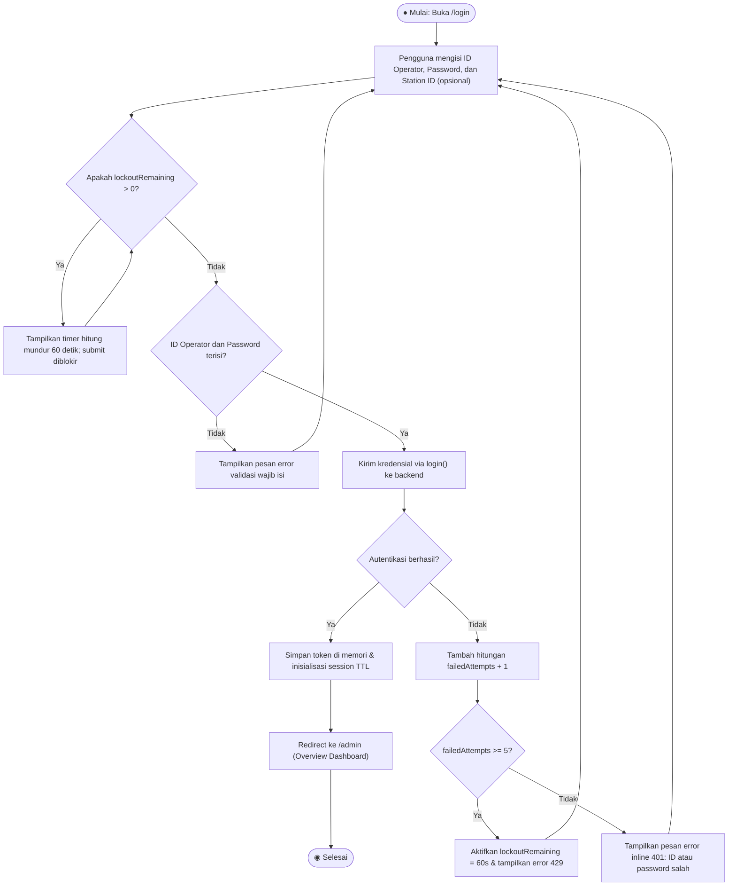

---

## 2. Overview Dashboard (`/admin`)

- **Rute**: `/admin`
- **Komponen**: `src/features/overview/OverviewPage.tsx`
- **Hak Akses**: Semua role (`ADMIN`, `SUPERVISOR`, `OPERATOR`, `MAINTENANCE`), mode baca tersedia di LAN & Remote Tunnel

### Deskripsi & Tujuan
Halaman ringkasan eksekutif (*command center* read-only) yang menyajikan potret kesehatan infrastruktur IIoT, status armada mesin/perangkat secara real-time, antrean insiden downtime aktif, serta event operasional terbaru dalam satu layar. Tujuannya adalah membantu supervisor, admin, dan tim IT/OT memindai kondisi pabrik secara cepat dan menavigasi langsung ke modul terkait tanpa melakukan mutasi berisiko dari layar ringkasan.

### Data yang Disajikan
| Bagian UI | Data / Metrik | Sumber Data | Tujuan Penyajian |
|---|---|---|---|
| **Section A: Core Infrastructure Health** | Status & latensi **API v1** (status, ms, uptime — tanpa versi Fastify), **Time-Series Database** (TimescaleDB/PostgreSQL, ms — tanpa metrik pool koneksi), **MQTT Mosquitto** (`Mosquitto 2.0.x`, status Dynamic Security, jumlah active clients), **WebSocket Stream** (`/ws/telemetry`, status Live Relay, jumlah active listeners), serta utilisasi **Telemetry Buffer (%)** (tanpa `records/sec`) | `GET /health` | Memantau kesehatan 4 pilar layanan backend & ingest data |
| **Section B: Production Overview KPIs** | 4 `MetricCard`: **Registered Devices** (total, online vs offline), **Registered Machines** (total, jumlah terikat ESP32), **Active Work Orders** (jumlah `ACTIVE` & `PENDING`), **Active Downtimes** (jumlah insiden aktif yang butuh klasifikasi) | `GET /api/v1/devices`, `GET /api/v1/machines`, `GET /api/v1/work-orders`, `GET /api/v1/downtime-events/active` | Ringkasan kuantitatif aset dan beban operasional aktif |
| **Section C: Fleet OEE Snapshot** | Rata-rata **Overall OEE (%)**, **Availability (%)**, **Performance (%)**, **Quality Rate (%)** dari mesin non-offline + **Tabel Live Armada** (Machine, Bound Device, FSM State badge, OEE %, Produced Good/Defect, Active Order) | `GET /api/v1/live-state` | Membandingkan performa live tiap mesin sekaligus mengarahkan ke Shift Analytics |
| **Section D: Recent Operational Events** | 4 event terbaru yang diagregasi di sisi klien per perangkat: severity badge (`CRITICAL`/`WARN`/`INFO`), event type, nama mesin, pesan, timestamp, dan status acknowledgement (`Ack'd` / `Unacknowledged`) | `GET /api/v1/operational-events/:deviceId` (agregasi per perangkat) | Memberi visibilitas alarm/kejadian terkini dan tautan ke Operational Events |
| **Section E: Quick Administrative Actions** | Daftar tautan cepat ke Create Work Order, Register Edge Device, Bind Device to Machine, Manage MQTT Dynamic Security, dan Mosquitto Configuration Manager | Navigasi statis | Mempercepat akses ke modul administratif utama |

### Activity Diagram Workflow
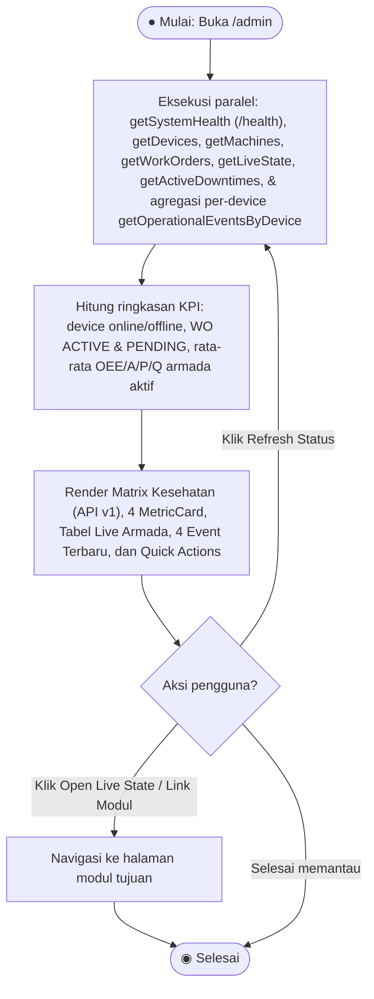

---

## 3. Work Orders (`/admin/work-orders`)

- **Rute**: `/admin/work-orders` (alias: `/admin/production/work-orders`)
- **Komponen**: `src/features/production/WorkOrdersPage.tsx`, `src/features/production/WorkOrderWizardModal.tsx`
- **Hak Akses**: Baca semua role; Buat/Dispatch/Complete (`ADMIN`, `SUPERVISOR`, `OPERATOR` di LAN); Cancel (`ADMIN` di LAN)

### Deskripsi & Tujuan
Halaman administrasi siklus hidup (*lifecycle*) perintah kerja produksi (Work Order) mulai dari inisiasi menggunakan **Four-Zone Poka-Yoke Wizard**, pengiriman konfigurasi batch ke mesin (*dispatch*), penyelesaian batch dengan pencatatan *reject* akhir (*complete*), hingga pembatalan (*cancel*). Tujuannya adalah menjamin setiap batch produksi divalidasi bebas konflik mesin/operator sebelum dijalankan di lantai produksi dan tercatat lengkap untuk kalkulasi OEE.

### Data yang Disajikan
| Bagian UI | Data / Kolom | Sumber Data | Tujuan Penyajian |
|---|---|---|---|
| **Filter Toolbar** | Pencarian teks (WO#, Produk, Mesin, Operator), filter dropdown **Status** (`ALL`, `PENDING`, `ACTIVE`, `COMPLETED`, `ABORTED`), filter dropdown **Machine** | State lokal atas daftar WO & mesin | Mempermudah pencarian dan penyaringan batch produksi |
| **Tabel Work Orders** | `Order Number` (mono), `Product` (nama & ID), `Machine` (nama & ID), `Operator & Shift`, `Progress / Target` (completed/target pcs, persentase, progress bar), `Status` (badge warna), `Actions` (Dispatch/Complete/Abort sesuai status & role) | `GET /api/v1/work-orders`, `GET /api/v1/products`, `GET /api/v1/machines`, `GET /api/v1/devices`, `GET /api/v1/operators` | Memantau progres dan mengendalikan transisi status tiap Work Order |
| **Four-Zone Wizard Modal** | **Zone 1**: Kartu produk (`name`, `sku`, `ideal_cycle_time_seconds` — tanpa deskripsi), input target kuantitas; **Zone 2**: Daftar mesin (`name`, `code`, `modbus_slave_id`, status device terikat — tanpa `line`) & deteksi konflik `BUSY`; **Zone 3**: Daftar operator aktif (`name`, `operator_id`, `role`, `shift_preference` — tanpa email/departemen/employee_code); **Zone 4**: Pilihan shift & ringkasan 4 zona | Master Products, Machines, Devices, Operators, Active WOs (`POST /api/v1/work-orders/initiate-from-zones`) | Validasi Poka-Yoke 4 zona sebelum menerbitkan WO baru |
| **Dialog Complete / Cancel / Dispatch** | Ringkasan dampak batch; input `Final Reject Count` (integer `>= 0`) & catatan pada Complete; input alasan pembatalan (`<= 500` karakter) pada Abort (`ABORTED`) | Input pengguna & konteks WO | Menjamin konfirmasi eksplisit dan pencatatan kualitas akhir/audit |

### Activity Diagram Workflow
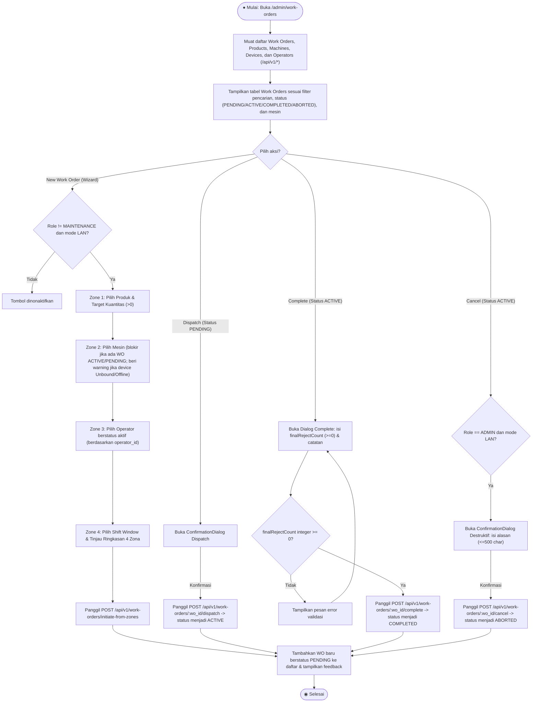

---

## 4. Downtime Events (`/admin/downtime`)

- **Rute**: `/admin/downtime` (alias: `/admin/monitoring/downtime`)
- **Komponen**: `src/features/monitoring/DowntimeEventsPage.tsx`, `src/features/monitoring/DowntimeReasonModal.tsx`
- **Hak Akses**: Semua role dapat membaca & melihat antrean; pelabelan/ekspor mengikuti izin role & mode jaringan (LAN untuk mutasi; ekspor khusus `ADMIN`/`SUPERVISOR`)

### Deskripsi & Tujuan
Halaman administrasi kejadian berhentinya mesin (*stoppage*), mencakup antrean insiden downtime yang sedang berlangsung (*live*), grafik Pareto distribusi kategori downtime, riwayat insiden hingga retensi 90 hari dengan paginasi cursor, pelabelan akar masalah berbasis 10 kategori TPM kanonis & *Six Big Losses*, serta ekspor data historis (CSV/NDJSON/JSON). Tujuannya adalah memastikan seluruh downtime terklasifikasi untuk analisis perbaikan keandalan mesin dan perhitungan rugi Availability/Performance.

### Data yang Disajikan
| Bagian UI | Data / Kolom | Sumber Data | Tujuan Penyajian |
|---|---|---|---|
| **HistoricalExportToolbar** | Preset rentang waktu (`24 Jam`, `7 Hari`, `30 Hari`, `90 Hari`, `Kustom`), tombol ekspor `CSV` / `NDJSON` / `JSON`, metadata hasil ekspor (`X-Export-*`), dan error retensi (`RETENTION_EXCEEDED` / `403`) | Context user & konfigurasi retensi (90 hari) | Mengatur jendela waktu kueri dan mengunduh data historis |
| **Active Downtimes Highlight Strip** | Daftar insiden aktif: nama mesin, status label (`Perlu alasan` / `Terlabeli`), alasan saat ini, durasi berjalan, waktu mulai, tombol `Beri Alasan` / `Ubah Label` | `GET /api/v1/downtime-events/active` | Menyorot mesin yang sedang berhenti agar segera ditindaklanjuti |
| **Chart Pareto Kategori Downtime** | Ranking 10 kategori TPM kanonis: durasi total, jumlah insiden, persentase dampak, persentase kumulatif, indikator `80/20 Key` | Kalkulasi atas dataset downtime termuat | Mengidentifikasi penyebab downtime paling dominan (prinsip 80/20) |
| **Filter Toolbar & Tabel Histori** | Filter server: Perangkat & `unlabeled_only`; Filter lokal: Kategori (10 enum TPM). Kolom tabel: `Mesin & Perangkat` (`[dihapus]` jika historis), `Kategori TPM & Six Big Losses` (pilar OEE), `Akar Masalah (Reason)`, `Durasi`, `Waktu Mulai / Selesai`, `Operator / Status`, `Aksi` (`Label`) | `GET /api/v1/downtime` (paginasi cursor) & `mapDowntimeToSixBigLoss()` | Audit mendetail seluruh catatan henti mesin historis |
| **CursorPaginationBar** | Jumlah rekaman dimuat vs total, `next_cursor`, pemilih `Per halaman` (`10`/`20`/`50`), tombol `Muat Lebih Banyak` & `Halaman Awal` | Metadata paginasi server | Navigasi dataset besar tanpa membebani memori |
| **DowntimeReasonModal** | Pilihan 10 kategori TPM, textarea deskripsi akar masalah & tindakan korektif, waktu mulai & selesai insiden | Event downtime terpilih | Mengklasifikasikan atau memperbarui alasan downtime (`POST /api/v1/downtime-events/:id/reason`) |

### Activity Diagram Workflow


---

## 5. Operational Events (`/admin/audit`)

- **Rute**: `/admin/audit` (alias: `/admin/monitoring/events`)
- **Komponen**: `src/features/monitoring/OperationalEventsPage.tsx`
- **Hak Akses**: Semua role dapat membaca & memfilter; tombol `Acknowledge` diblokir pada mode Remote Tunnel; ekspor khusus `ADMIN`/`SUPERVISOR`

### Deskripsi & Tujuan
Halaman aliran kejadian operasional (*operational event stream*) per perangkat maupun agregasi lintas-perangkat di sisi klien (tanpa mengasumsikan endpoint global `/operational-events`), yang merekam alarm mesin, transisi FSM, eksekusi perintah, pemutusan koneksi (*disconnect*), dan *heartbeat timeout*, dilengkapi mekanisme **Acknowledgement** oleh operator/supervisor serta fitur ekspor. Tujuannya adalah memastikan setiap anomali atau alarm operasional ditanggapi, dicatat siapa penanggung jawabnya beserta catatan tindak lanjut, dan dapat diekspor melalui `/api/v1/operational-events/:deviceId/export` untuk investigasi.

### Data yang Disajikan
| Bagian UI | Data / Kolom | Sumber Data | Tujuan Penyajian |
|---|---|---|---|
| **HistoricalExportToolbar** | Preset waktu (`24 Jam` s.d. `90 Hari` / `Kustom`), label cakupan (`Mode: Agregasi Per-Device (/api/v1/operational-events/:deviceId)` vs `Per-Device`), tombol ekspor `CSV` / `NDJSON` / `JSON`, serta receipt/error ekspor | Context & state filter | Mengatur rentang waktu & mengekspor log event operasional per perangkat |
| **Filter Toolbar** | Dropdown `Scope Perangkat` (`Semua Perangkat (Agregasi Per-Device)` atau per `device_id`), dropdown `Event Type` (`ALL`, `ALARM`, `STATE_CHANGE`, `COMMAND_EXECUTED`, `DISCONNECT`, `HEARTBEAT_TIMEOUT`), counter jumlah termuat vs total | `GET /api/v1/devices` & state filter | Memfokuskan inspeksi pada perangkat dan tipe event tertentu |
| **Tabel Operational Events** | `Severity & Type` (`CRITICAL`/`WARN`/`INFO` + jenis event), `Target Machine` (nama mesin & `device_id`), `Message / Payload`, `Timestamp`, `Status & Ack By` (`Acknowledged` + nama operator atau `Unacknowledged`), `Action` (`Acknowledge` / `Resolved`) | `GET /api/v1/operational-events/:deviceId` (paginasi cursor / agregasi per perangkat) | Menampilkan kronologi kejadian operasional dan status penanganannya |
| **ConfirmationDialog Acknowledge** | Info mesin & tipe event, isi pesan event, daftar dampak audit, textarea `Acknowledgement Note` (opsional, maks. 500 karakter) | `PATCH /api/v1/operational-events/:id/ack` | Mencatat pengakuan alarm secara resmi ke jejak audit |

### Activity Diagram Workflow
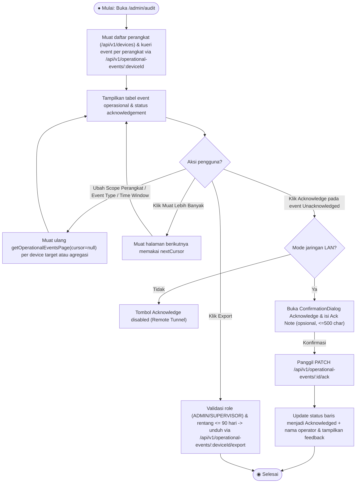

---

## 6. Live Machine State (`/admin/live-state`)

- **Rute**: `/admin/live-state` (alias: `/admin/monitoring/live-state`)
- **Komponen**: `src/features/monitoring/LiveStatePage.tsx`
- **Hak Akses**: Semua role (`ADMIN`, `SUPERVISOR`, `OPERATOR`, `MAINTENANCE`), mode baca saja (LAN & Remote Tunnel)

### Deskripsi & Tujuan
Konsol pemantauan keadaan mesin secara langsung (*live*) yang melakukan polling berkala setiap 10 detik (serta mendukung penyegaran manual) untuk menampilkan state FSM terbaru, indeks OEE real-time, jumlah produk baik/cacat, durasi jalan/henti, dan batch aktif pada setiap mesin. Tujuannya adalah memberikan visibilitas lantai produksi secara cepat bagi tim pengawas tanpa menyediakan tombol aktuasi mesin di Admin Panel.

### Data yang Disajikan
| Bagian UI | Data / Kolom | Sumber Data | Tujuan Penyajian |
|---|---|---|---|
| **Filter Bar** | Input pencarian (Nama Mesin, Device ID, atau Work Order aktif) & dropdown filter `FSM State` (`ALL`, `RUNNING`, `READY`, `DOWNTIME`, `OFFLINE`) | State filter lokal | Menyaring mesin berdasarkan status operasi atau batch |
| **Tabel Live Machine State** | `Machine & Device` (nama mesin & `device_id`), `FSM State` (`MachineStateBadge` dengan ikon + warna), `OEE Index` (kode warna >=85% hijau, >=70% biru, >0% amber), `Avail · Perf · Qual` (%), `Parts (Good / Rej)`, `Run / Down Time` (format durasi), `Active Batch` (nomor WO & produk atau `Idle / No Order`) | `GET /api/v1/live-state` (auto-polling tiap 10 detik) | Memantau performa dan status aktual tiap mesin secara real-time |

### Activity Diagram Workflow
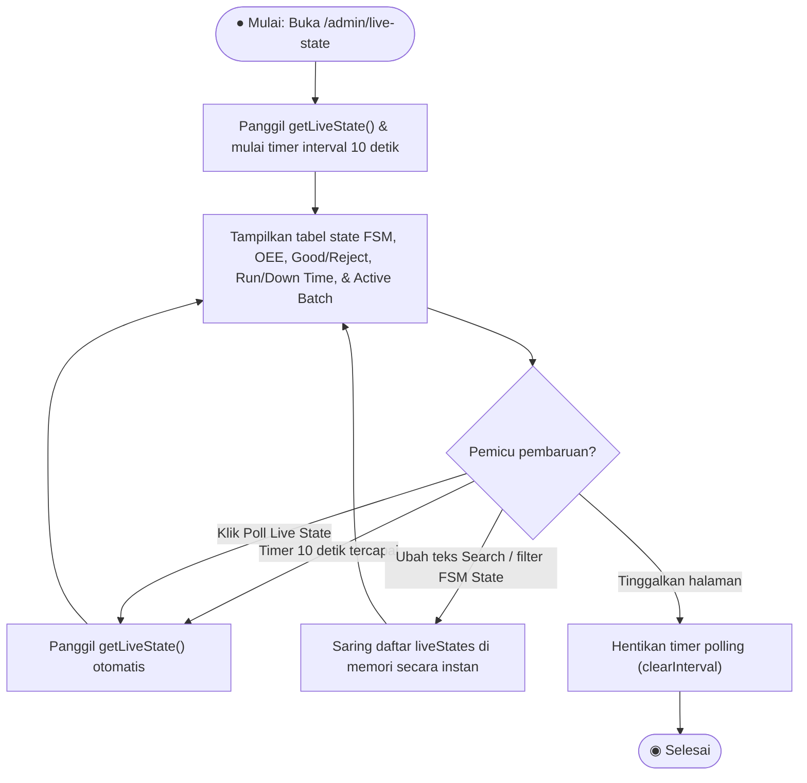

---

## 7. Edge Devices (`/admin/devices`)

- **Rute**: `/admin/devices` (alias: `/admin/assets/devices`)
- **Komponen**: `src/features/assets/DevicesPage.tsx`, `src/features/assets/DeviceHealthDrawer.tsx`
- **Hak Akses**: Semua role dapat membaca & membuka drawer diagnostik; pendaftaran perangkat baru diblokir di Remote Tunnel (`isReadOnly`)

### Deskripsi & Tujuan
Halaman registri perangkat kontroler edge (ESP32-S3 / STM32) yang mencatat identitas jaringan, versi firmware, status kehadiran (*presence* `ONLINE`/`OFFLINE`), mesin yang terikat, dan waktu telemetri terakhir, serta menyediakan panel samping **Device Health Drawer** untuk diagnostik cache Redis & FreeRTOS perangkat keras. Tujuannya adalah mengelola inventaris node IoT lapangan dan memverifikasi kesehatan memori (`heapFree`) serta *task* RTOS pada setiap perangkat.

### Data yang Disajikan
| Bagian UI | Data / Kolom | Sumber Data | Tujuan Penyajian |
|---|---|---|---|
| **Search Toolbar** | Pencarian berdasarkan Serial Number, IP Address, MAC Address, atau Bound Machine | Filter lokal | Menemukan unit kontroler edge tertentu dengan cepat |
| **Tabel Edge Devices** | `Serial Number` (mono), `Network Coordinates` (IP & MAC Address), `Firmware`, `Presence State` (`ONLINE`/`OFFLINE` dengan indikator titik & warna), `Bound Machine` (nama mesin atau `Unbound`), `Last Telemetry` (timestamp), `Diagnostics` (tombol buka drawer) | `GET /api/v1/devices` | Pemantauan kesiapan konektivitas dan pemetaan aset IoT |
| **Modal Register Edge Device** | Form input: `Hardware Serial Number`, `MAC Address`, `Static IP Address`, `Firmware Version` | Input admin | Mendaftarkan identitas hardware baru (`POST /api/v1/devices`) |
| **DeviceHealthDrawer** | Identitas & binding perangkat; metrik **Heap Free** (`heapFree` bytes), **RTOS Tasks** (`tasksHealthy / tasksTotal`), **Cache Age** (`ageSec` detik — menangani *cache miss* `ageSec >= 999999`), **Stale Count** (`staleCount`), **Stale Tasks** (`staleTasks`), dan **Event Flags** (`eventFlags`) tanpa field `wifi_rssi` atau `uptime_sec` | `GET /api/v1/devices/:id/health` | Diagnostik kesehatan internal RTOS dari cache backend secara jujur tanpa data sintetis |

### Activity Diagram Workflow
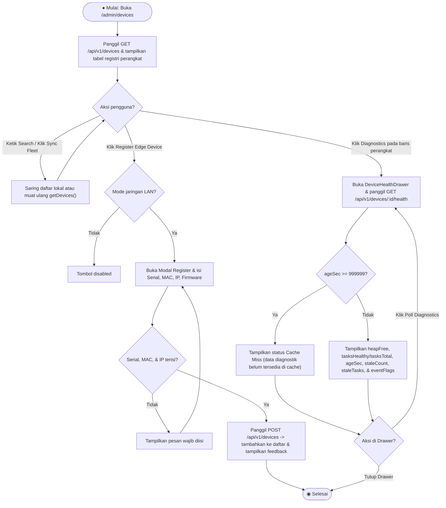

---

## 8. Machines (`/admin/machines`)

- **Rute**: `/admin/machines` (alias: `/admin/assets/machines`)
- **Komponen**: `src/features/assets/MachinesPage.tsx`
- **Hak Akses**: Semua role dapat membaca; pendaftaran mesin serta operasi Bind/Unbind diblokir di Remote Tunnel (`isReadOnly`)

### Deskripsi & Tujuan
Halaman master aset mesin fisik produksi (seperti CNC Milling, Hydraulic Press, dll.) beserta pengalamatan **Modbus Slave ID (1–247)** dan manajemen relasi ikatan **1-to-1** (*binding*) antara mesin fisik dengan perangkat kontroler edge ESP32. Tujuannya adalah memastikan setiap mesin di lini produksi terpetakan secara akurat ke satu perangkat pengumpul telemetri agar data OEE tidak tertukar atau hilang.

### Data yang Disajikan
| Bagian UI | Data / Kolom | Sumber Data | Tujuan Penyajian |
|---|---|---|---|
| **Tabel Machines** | `Machine Code` (mono), `Machine Name`, `Modbus Slave ID`, `Bound Edge Device` (serial device & status Online/Offline, atau `Unbound (No Telemetry)`), `Binding Actions` (`Bind Device` jika kosong, `Unbind` jika terikat) — tanpa kolom `Production Line` atau `Status` | `GET /api/v1/machines`, `GET /api/v1/devices` | Memeriksa topologi mesin fisik, alamat Modbus, dan status keterikatan perangkat IoT |
| **Modal Register Machine** | Input `Machine Asset Name`, `Asset Code / Tag`, `Modbus Slave ID` (1–247) | Input admin (`POST /api/v1/machines`) | Menambahkan aset mesin baru ke registri |
| **Modal Bind Edge Device** | Daftar perangkat edge yang tersedia beserta status (`ONLINE`/`OFFLINE`), IP, MAC, dan penanda `Rebinding from ...` jika perangkat sudah terikat mesin lain | `POST /api/v1/machines/:id/bind` | Mengikat 1 perangkat edge ke mesin target |
| **ConfirmationDialog Unbind** | Nama & kode mesin, ID perangkat terikat, daftar dampak (penghentian sementara stream telemetri & pencatatan OEE real-time) | `POST /api/v1/machines/:id/unbind` | Konfirmasi destruktif sebelum melepas ikatan 1-to-1 perangkat |

### Activity Diagram Workflow


---

## 9. Products (`/admin/products`)

- **Rute**: `/admin/products` (alias: `/admin/production/products`)
- **Komponen**: `src/features/production/ProductsPage.tsx`
- **Hak Akses**: Menu sidebar tampil untuk `ADMIN` & `SUPERVISOR`; mutasi create/delete diblokir pada Remote Tunnel (`isReadOnly`)

### Deskripsi & Tujuan
Halaman katalog master produk (SKU) yang menyimpan parameter **Standard Ideal Cycle Time (detik)** dan status keaktifan SKU. Tujuannya adalah menyediakan tolok ukur waktu siklus desain (*benchmark* performa 100%) yang digunakan oleh mesin kalkulasi OEE untuk menghitung komponen **Performance**, serta meneruskan penghapusan ke backend (`409` jika SKU masih direferensikan oleh Work Order berstatus `PENDING` atau `ACTIVE`).

### Data yang Disajikan
| Bagian UI | Data / Kolom | Sumber Data | Tujuan Penyajian |
|---|---|---|---|
| **Tabel Products** | `SKU / Code` (mono), `Product Name` + `product_id`, `Standard Cycle Time` (satuan `s`), `Status` (`ACTIVE`/`INACTIVE`), `Actions` (tombol hapus; nonaktif pada Remote Tunnel) — tanpa `Category`, `Description`, maupun `Active Orders` | `GET /api/v1/products` | Menampilkan standar cycle time tiap SKU dan status aktifnya |
| **Modal Add New Product SKU** | Input `SKU Identifier`, `Product Name`, `Standard Ideal Cycle Time (Seconds)` (`> 0`) | Input pengguna (`POST /api/v1/products`) | Menambahkan master SKU baru ke katalog |
| **ConfirmationDialog Delete** | Nama & SKU produk, daftar dampak (SKU tidak bisa dipilih untuk WO baru, histori WO selesai menampilkan `[dihapus]`, ditolak 409 jika ada WO berstatus `PENDING` atau `ACTIVE`) | `DELETE /api/v1/products/:id` | Konfirmasi destruktif penghapusan SKU |

### Activity Diagram Workflow


---

## 10. Operators (`/admin/operators`)

- **Rute**: `/admin/operators` (alias: `/admin/production/operators`)
- **Komponen**: `src/features/production/OperatorsPage.tsx`
- **Hak Akses**: `ADMIN` & `SUPERVISOR` (di LAN untuk mutasi registrasi, rotasi password, dan ubah status)

### Deskripsi & Tujuan
Halaman direktori personel pabrik dan pengelolaan akun operator berbasis **`operator_id`**, role RBAC (`OPERATOR`, `SUPERVISOR`, `MAINTENANCE`, `ADMIN`), preferensi shift, status keaktifan, serta rotasi password sekali tulis (*write-only*). Tujuannya adalah mengelola identitas operator yang dapat masuk ke sistem atau ditugaskan pada Work Order, sambil melindungi akun root administrator **`ADM-001`** dari penonaktifan atau penghapusan.

### Data yang Disajikan
| Bagian UI | Data / Kolom | Sumber Data | Tujuan Penyajian |
|---|---|---|---|
| **Tabel Operators** | `Operator ID` (mono, misal `ADM-001`, `EMP-0042`), `Operator Name` (badge `ROOT` untuk `ADM-001`) + `shift_preference` opsional, `Role & Access` (badge warna per role), `Status` (`Active` / `Deactivated`), `Actions` (label `Akun dilindungi sistem` untuk `ADM-001`, atau tombol `Password` & `Activate`/`Deactivate`) — tanpa `Employee Code`, `email`, maupun `department` | `GET /api/v1/operators` | Mengelola daftar personel aktif dan hak akses dasarnya |
| **Modal Register Factory Operator** | Input `Operator ID`, `Full Name`, `Role`, `Shift Preference`, serta catatan penyediaan password sementara (di-hash Argon2id oleh API v1 backend) | `POST /api/v1/operators` | Mendaftarkan akun operator baru |
| **Modal Rotasi Password** | Input `Password Baru` (8–128 karakter, `type="password"`, tidak pernah ditampilkan ulang setelah disimpan) | `PATCH /api/v1/operators/:id/password` | Mengganti kredensial operator dengan aman |
| **ConfirmationDialog Toggle Status** | Nama & `operator_id`; jika menonaktifkan: dampak pada refresh token sesi aktif, pemblokiran login `/login` & Station, serta retensi data historis | `PATCH /api/v1/operators/:id/status` | Konfirmasi sebelum mengaktifkan/menonaktifkan akses login operator |

### Activity Diagram Workflow
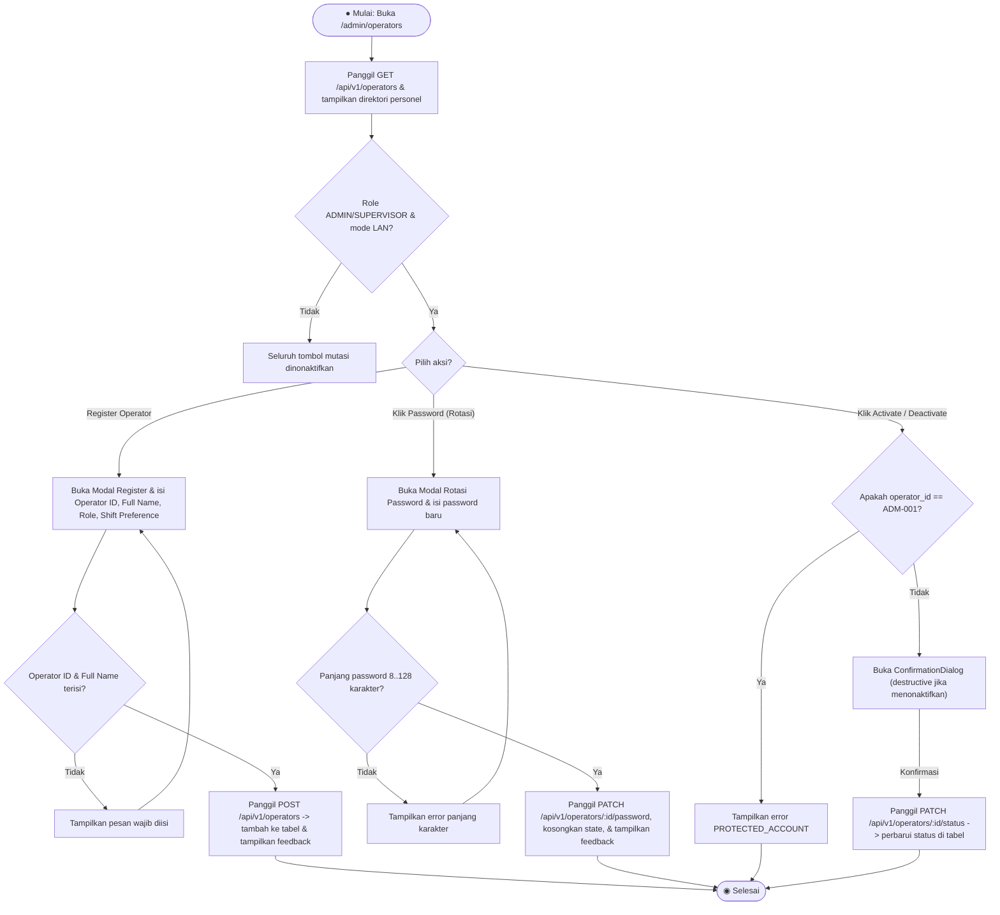

---

## 11. Telemetry History (`/admin/telemetry`)

- **Rute**: `/admin/telemetry` (alias: `/admin/analytics/telemetry`)
- **Komponen**: `src/features/analytics/TelemetryHistoryPage.tsx`
- **Hak Akses**: Semua role dapat membaca & memfilter; ekspor khusus `ADMIN`/`SUPERVISOR`

### Deskripsi & Tujuan
Halaman arsip histori telemetri mentah (*raw time-series*) dari *hypertable* TimescaleDB untuk perangkat edge terpilih, dilengkapi pemilih rentang waktu (maksimal retensi 90 hari), paginasi cursor urutan menurun (*terbaru*), dan ekspor data dalam format CSV, NDJSON, maupun JSON. Tujuannya adalah memungkinkan inspeksi granular paket telemetri historis per detik/siklus (counter, OEE, cycle time, suhu, dan getaran) untuk investigasi teknis maupun pelaporan terstruktur.

### Data yang Disajikan
| Bagian UI | Data / Kolom | Sumber Data | Tujuan Penyajian |
|---|---|---|---|
| **HistoricalExportToolbar** | Preset waktu (`24 Jam`, `7 Hari`, `30 Hari`, `90 Hari`, `Kustom`), cakupan perangkat aktif, tombol `Export CSV` / `NDJSON` / `JSON`, receipt `X-Export-*` & validasi retensi | Context & state rentang waktu | Membatasi kueri dalam jendela waktu valid & mengunduh data mentah |
| **Device Selector Bar** | Dropdown pilih perangkat (`serial_number (device_id)`), informasi jumlah rekaman dimuat vs total | `GET /api/v1/devices` | Menentukan sumber perangkat untuk kueri log telemetri |
| **Tabel Raw Telemetry** | `Timestamp (UTC)`, `State` (FSM state), `Total / Good / Rej` (counter produksi), `OEE (%)`, `Cycle Time` (detik), `Thermal (°C)`, `Vibration (RMS mm/s)` | `GET /api/v1/telemetry/:device_id/history` (paginasi cursor) | Menyajikan detail metrik sensor dan produksi historis |
| **CursorPaginationBar** | Ringkasan jumlah dimuat, `next_cursor`, pemilih limit (`10`/`20`/`50`), tombol `Muat Lebih Banyak` & `Halaman Awal` | Metadata paginasi server | Memuat data historis secara bertahap tanpa overload |

### Activity Diagram Workflow
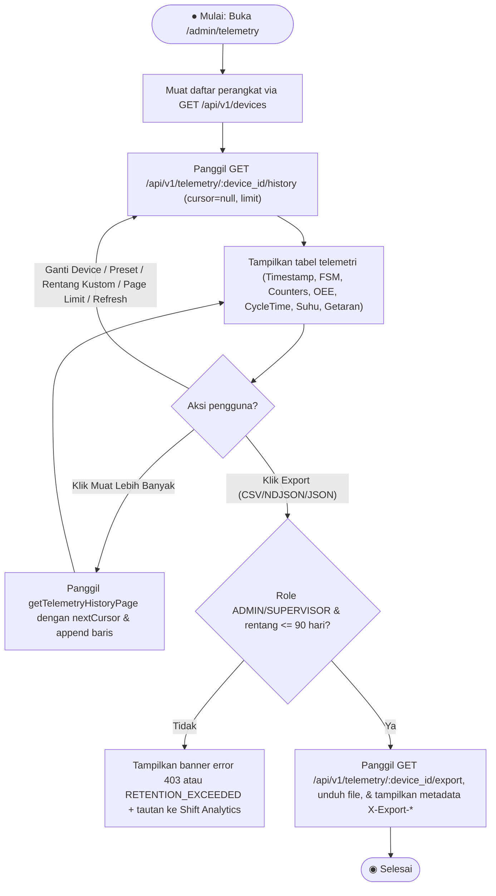

---

## 12. Shift Analytics / OEE Analytics (`/admin/shift-analytics`)

- **Rute**: `/admin/shift-analytics` (alias: `/admin/analytics/oee`)
- **Komponen**: `src/features/analytics/OeeAnalyticsPage.tsx`
- **Hak Akses**: Semua role (`ADMIN`, `SUPERVISOR`, `OPERATOR`, `MAINTENANCE`), mode baca saja (LAN & Remote Tunnel)

### Deskripsi & Tujuan
Halaman analitik OEE berbasis jendela shift yang menyajikan dekomposisi komponen **Availability**, **Performance**, dan **Quality** per mesin, garis waktu status FSM shift (*Shift State Timeline*), serta profil tren telemetri per jam untuk perangkat edge yang terikat ke mesin. Jika mesin belum memiliki `bound_device_id`, halaman secara jujur menampilkan bahwa tren per jam tidak tersedia tanpa data sintetis.

### Data yang Disajikan
| Bagian UI | Data / Metrik | Sumber Data | Tujuan Penyajian |
|---|---|---|---|
| **Selectors Bar** | Pemilih **Machine** (`name (code) · device_id/Unbound`), pemilih **Shift Window**, indikator normalisasi shift, & `Bound Telemetry Source` | `GET /api/v1/machines` & filter shift | Memilih mesin dan mengidentifikasi `bound_device_id` target |
| **KPI Decomposition Grid** | 4 `MetricCard`: **Shift OEE Index** (% vs target >=85%), **Availability Rate** (% + `Operating min / Planned min`), **Performance Rate** (% + `Run min` & `Total Parts`), **Quality Rate** (% + `Good parts` vs `Defect parts`) | `GET /api/v1/oee/shift-summary` | Memecah penyebab naik/turunnya OEE ke tiga pilar utama |
| **Shift State Timeline** | Strip visual & legenda segmen `RUNNING` / `DOWNTIME` / `READY` beserta durasi menit | `GET /api/v1/oee/shift-timeline` | Memvisualisasikan kronologi transisi FSM dalam jendela shift |
| **Hourly Telemetry Trend** | Daftar tren per jam untuk `bound_device_id` terpilih (atau pesan kosong jujur jika mesin `Unbound`): OEE %, A/P/Q %, progress bar, jumlah unit & cacat | `GET /api/v1/telemetry/:device_id/hourly` | Melacak fluktuasi telemetri per jam perangkat edge terkait |

### Activity Diagram Workflow


---

## 13. Quality & Rejects (`/admin/quality`)

- **Rute**: `/admin/quality` (alias: `/admin/analytics/quality`)
- **Komponen**: `src/features/analytics/QualityRejectsPage.tsx`
- **Hak Akses**: Semua role (`ADMIN`, `SUPERVISOR`, `OPERATOR`, `MAINTENANCE`), mode baca saja (LAN & Remote Tunnel)

### Deskripsi & Tujuan
Halaman analisis kualitas produksi dan *reject* per perangkat edge menggunakan pendekatan **Pareto 80/20** untuk memetakan penyebab produk cacat (*scrap*/*defect*). Jika perangkat terpilih tidak memiliki catatan cacat pada periode berjalan, UI menampilkan pesan jujur `"Tidak ada reject pada periode ini"` tanpa menampilkan angka yield palsu.

### Data yang Disajikan
| Bagian UI | Data / Metrik | Sumber Data | Tujuan Penyajian |
|---|---|---|---|
| **Device Selector** | Dropdown pilih perangkat (`device_id (bound_machine_name / serial_number)`) | `GET /api/v1/devices` | Menentukan perangkat target untuk kueri reject Pareto |
| **Ringkasan KPI Kualitas** | 3 `MetricCard`: **Total Defect Units** (jumlah unit cacat perangkat terpilih), **Top Contributor** (persentase & nama alasan terbesar), **Defect Categories** (jumlah jenis alasan reject tercatat) — tanpa nilai `Plant Quality Yield` hardcoded | `GET /api/v1/quality/rejects/:device_id` | Memberikan gambaran cepat tingkat cacat dan jumlah kategorinya |
| **Ranked Defect Causes & Cumulative Impact** | Daftar peringkat alasan cacat (atau pesan `"Tidak ada reject pada periode ini"` jika kosong): nomor urut, alasan (`reason`), jumlah unit, persentase, persentase kumulatif, & bar visual | `GET /api/v1/quality/rejects/:device_id` | Visualisasi distribusi Pareto 80/20 penyebab cacat per perangkat |

### Activity Diagram Workflow


---

## 14. Data Reconciliation (`/admin/reconciliation`)

- **Rute**: `/admin/reconciliation` (alias: `/admin/analytics/reconciliation`)
- **Komponen**: `src/features/analytics/DataReconciliationPage.tsx`
- **Hak Akses**: Semua role dapat melihat status job; aksi `Force Refresh` hanya diizinkan untuk `ADMIN` & `SUPERVISOR` dari **LAN Pabrik** (`canForceReconciliationRefresh`)

### Deskripsi & Tujuan
Halaman pemantauan dan manajemen job rekonsiliasi **Continuous Aggregate (CAGG)** TimescaleDB yang bertugas melakukan *rollup* otomatis setiap 15 menit dan sinkronisasi data *backfill* pada *materialized view*. Tujuannya adalah memastikan data agregasi analitik OEE selalu sinkron dengan telemetri mentah serta memberi kemampuan *force refresh* manual secara terkendali (dilengkapi *rate limit* 60 detik per view untuk melindungi I/O database).

### Data yang Disajikan
| Bagian UI | Data / Kolom | Sumber Data | Tujuan Penyajian |
|---|---|---|---|
| **Tabel Reconciliation Jobs** | `Continuous Aggregate Job` (nama job), `Materialized View` (nama view mono), `Schedule Interval`, `Reconciliation Window` (jam & jumlah baris diproses), `Last Execution` (timestamp), `Job Status` (`last_status` dengan ikon sukses), `Manual Action` (tombol `Force Refresh`) | `GET /api/v1/telemetry/reconciliation/jobs` | Memantau kesehatan jadwal agregasi otomatis & hasil eksekusi terakhir |
| **Panel Kebijakan Rekonsiliasi** | Informasi interval otomatis 15 menit, syarat hak akses (`ADMIN`/`SUPERVISOR` di LAN), dan kebijakan rate-limit 1 permintaan per 60 detik per view | Teks kebijakan sistem | Mengedukasi operator mengenai batasan keamanan I/O database |
| **ConfirmationDialog Force Refresh** | Nama job & view, jendela waktu rekalkulasi, estimasi baris yang dihitung ulang, peringatan beban I/O & cooldown 60 detik | Konteks job terpilih | Konfirmasi berdampak layanan sebelum memicu rekalkulasi sinkron |

### Activity Diagram Workflow
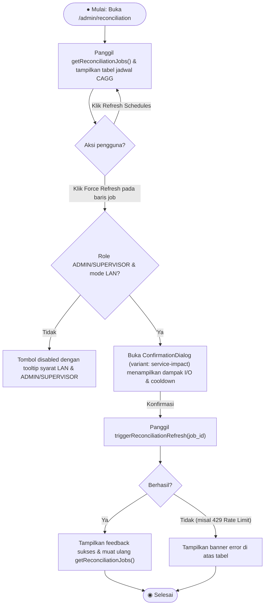

---

## 15. Broker Overview (`/admin/mqtt/overview`)

- **Rute**: `/admin/mqtt/overview` (alias: `/admin/mqtt`)
- **Komponen**: `src/features/mqtt/BrokerOverviewPage.tsx`
- **Hak Akses**: Semua role pada menu/route langsung (di sidebar masuk grup MQTT & Connectivity)

### Deskripsi & Tujuan
Halaman ringkasan infrastruktur **Eclipse Mosquitto MQTT Broker** yang dikomposisikan dari `GET /api/v1/mqtt/dynamic-security/status` dan `GET /api/v1/mqtt/configuration/status` (tanpa memanggil `/mqtt/overview`). Tujuannya adalah menyajikan status plugin keamanan dinamis, jumlah klien/role/grup, serta status sinkronisasi konfigurasi broker sekaligus menjadi gerbang navigasi menuju sub-modul **Dynamic Security** dan **Broker Configuration Manager**.

### Data yang Disajikan
| Bagian UI | Data / Metrik | Sumber Data | Tujuan Penyajian |
|---|---|---|---|
| **Primary KPI Strip** | 4 `MetricCard`: **Broker Engine** (`Mosquitto 2.0.x` & status), **Dynamic Security Clients** (jumlah klien aktif, roles, & groups), **Dynamic Security** (`CONNECTED`/`DISCONNECTED` & status ACL), **Configuration Sync** (`sync_state` & `config_version`) — tanpa throughput `msg/s` atau uptime | `GET /api/v1/mqtt/dynamic-security/status`, `GET /api/v1/mqtt/dynamic-security/clients`, `GET /api/v1/mqtt/configuration/status` | Memantau konektivitas plugin keamanan dan sinkronisasi konfigurasi broker |
| **Kartu Sub-modul Dynamic Security** | Status koneksi plugin, inventaris Roles & Groups, tautan langsung ke `/admin/mqtt/security` | Data komposisi status + navigasi | Penjelasan ringkas dan akses cepat manajemen ACL/klien |
| **Kartu Sub-modul Configuration Manager** | Versi konfigurasi aktif (`config_version`), waktu penerapan terakhir (`last_config_applied`), tautan langsung ke `/admin/mqtt/configuration` | Data status konfigurasi + navigasi | Penjelasan ringkas dan akses cepat manajemen konfigurasi `mosquitto.conf` |

### Activity Diagram Workflow


---

## 16. Dynamic Security (`/admin/mqtt/security`)

- **Rute**: `/admin/mqtt/security`
- **Komponen**: `src/features/mqtt/DynamicSecurityPage.tsx`
- **Hak Akses**: Khusus `ADMIN`; seluruh aksi mutasi (Provision, Enable/Disable, Revoke) hanya aktif di **LAN Pabrik** (`!isReadOnly && currentUser.role === 'ADMIN'`)

### Deskripsi & Tujuan
Halaman administrasi plugin **Mosquitto Dynamic Security (`mosquitto_ctrl`)** melalui topik `$CONTROL/dynamic-security/v1` untuk mengelola kredensial klien MQTT, peran (*roles*), aturan *Access Control List* (ACL) per topik, dan keanggotaan grup tanpa perlu me-restart daemon broker. Tujuannya adalah mengamankan jalur komunikasi MQTT perangkat edge secara granular dan menerapkan kebijakan keamanan **secret tampil sekali** (*one-time password display*) saat provisioning klien baru.

### Data yang Disajikan
| Bagian UI (Tab) | Data / Elemen | Sumber Data | Tujuan Penyajian |
|---|---|---|---|
| **Tab 1: Plugin Status** | Status koneksi plugin (`CONNECTED`), versi integrasi admin (`Active v1.0`), jumlah entitas terdaftar (`Clients`, `Roles`, `Groups`), info penyimpanan `dynamic-security.json` | Hasil agregasi API klien/role/grup | Memastikan plugin kontrol dinamis aktif dan tersinkronisasi |
| **Tab 2: Clients** | Tabel klien: `Client Username`, `Client ID Pattern`, `Assigned Roles`, `Groups`, `Account State` (`Enabled`/`Disabled`), `Action` (`Enable`/`Disable`, `Revoke`) | `GET /api/v1/mqtt/dynamic-security/clients` | Mengaudit dan mengendalikan kredensial setiap node/klien MQTT |
| **Tab 3: Roles & ACLs** | Kartu per role: nama role, jumlah ACL, tabel aturan ACL (`Permission` ALLOW/DENY, `ACL Action Type`, `Topic Pattern`, `Priority`) | `GET /api/v1/mqtt/dynamic-security/roles` | Memeriksa izin publish/subscribe per pola topik |
| **Tab 4: Groups** | Kartu per grup: nama grup, `Inherited Roles`, daftar `Member Clients` | `GET /api/v1/mqtt/dynamic-security/groups` | Melihat pengelompokan klien dan pewarisan hak aksesnya |
| **Modal Provision MQTT Client** | Form: `Username`, `Client ID Pattern` (opsional), `Pre-Shared Password` (opsional/auto-generate), `Assign Security Role`; diikuti tampilan **Secret Sekali Tampil** dengan tombol `Salin` | Input admin & respons provisioning | Membuat akun MQTT baru dan menyerahkan secret secara aman (hilang permanen saat modal ditutup) |

### Activity Diagram Workflow
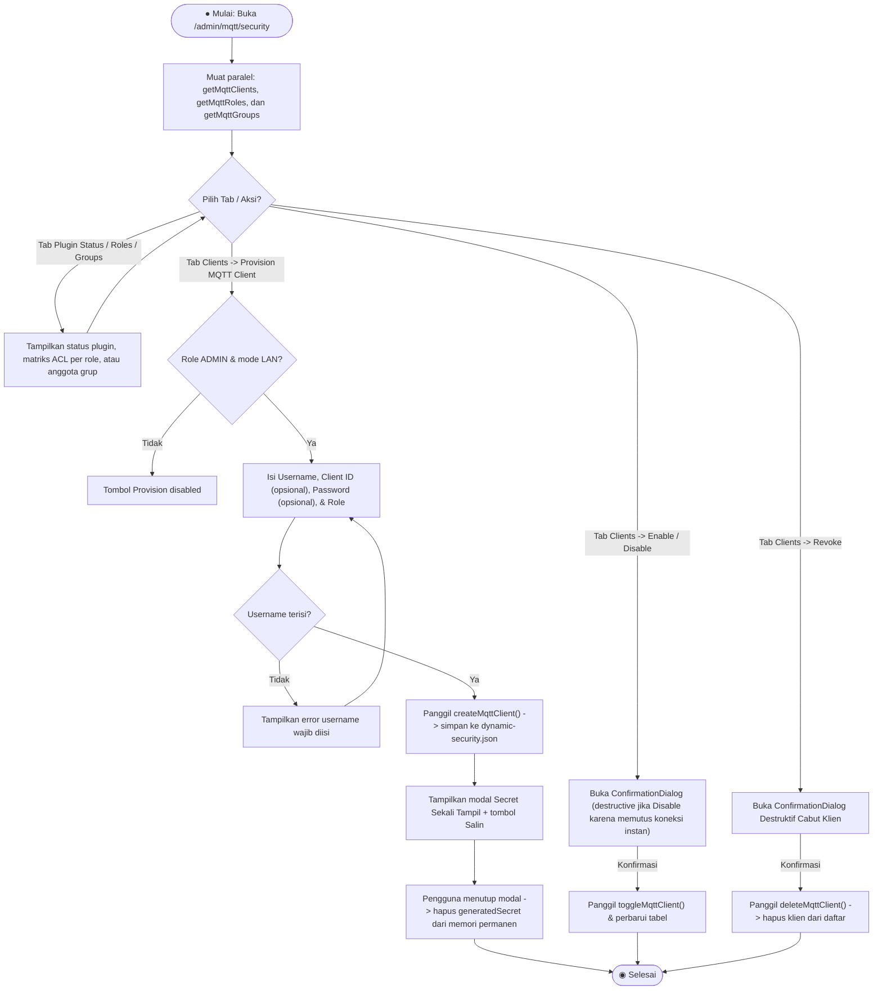

---

## 17. Broker Configuration Manager (`/admin/mqtt/configuration`)

- **Rute**: `/admin/mqtt/configuration` dan `/admin/mqtt/configuration/*`
- **Komponen**: `src/features/mqtt/BrokerConfigManagerPage.tsx`
- **Hak Akses**: `ADMIN` (baca & tulis di LAN); `SUPERVISOR` (baca-saja)

### Deskripsi & Tujuan
Halaman manajemen siklus hidup konfigurasi infrastruktur daemon Mosquitto (`mosquitto.conf`) berbasis versi. Seluruh sub-tab beroperasi pada satu dokumen kandidat lokal (*proposed config*) dengan alur terkendali: edit konfigurasi, validasi, pratinjau *diff* (*Current vs Proposed*), persetujuan admin dengan catatan audit (*Change Summary*), penerapan via sinyal `SIGHUP` tanpa *downtime*, hingga **Rollback** ke versi snapshot sebelumnya. Tujuannya adalah mencegah kesalahan konfigurasi broker yang dapat melumpuhkan telemetri seluruh pabrik.

### Data yang Disajikan
| Bagian UI (8 Tab) | Data / Elemen | Sumber Data | Tujuan Penyajian |
|---|---|---|---|
| **1. Overview** | `Active Version` & `Sync State` (`IN_SYNC`), `Broker Engine` (`Mosquitto 2.0.x` & `last_applied_at`), `Rollback Target`, serta diagram alur 6 tahap lifecycle konfigurasi | `GET /api/v1/mqtt/configuration`, `.../status`, & `.../configurations` | Ringkasan versi berjalan dan panduan alur perubahan |
| **2. General** | Pengaturan global: `Per-Listener Settings`, `Allow Anonymous`, `Database Persistence`, `Autosave Interval (detik)` | `proposedConfig.general` | Mengonfigurasi kebijakan autentikasi global dan persistensi |
| **3. Listeners** | Daftar listener jaringan: `Port`, `Protocol` (`mqtt`/`ws`), badge `TLS ACTIVE`, `Bind Address`, `Max Connections`, checkbox `Enabled` | `proposedConfig.listeners` | Mengelola port TCP dan WebSocket yang dibuka oleh broker |
| **4. TLS Profiles** | Kartu profil TLS: nama, status, `Server Cert` ref, `CA Authority` ref, versi TLS, wajib client cert; catatan keamanan bahwa private key tidak pernah dikirim ke browser | `proposedConfig.tls_profiles` | Meninjau profil enkripsi dan referensi sertifikat |
| **5. Bridges** | Daftar bridge korporat: nama, status, `Remote Target` (`address:port`), versi protokol, `Topic Mappings` (pattern, direction, QoS) | `proposedConfig.bridges` | Memantau jembatan penerusan topik antar broker |
| **6. Resource Limits** | Form batas daemon: `Max Allowed Client Connections`, `Max Inflight Messages`, `Max Packet Size (Bytes)`, `Max Queued Messages In RAM` | `proposedConfig.limits` | Mengatur kuota memori dan koneksi untuk mencegah kehabisan resource |
| **7. Diff & Review** | Pratinjau syntax diff bergaya unified (`Active` vs `Proposed`) + blok konfigurasi mentah (`GET /api/v1/mqtt/configuration/raw`), indikator operasi `RELOAD (SIGHUP) — No Broker Downtime` | Perbandingan `currentConfig` vs `proposedConfig` + `/raw` | Verifikasi visual perubahan sebelum dieksekusi |
| **8. Rollback History** | Tabel riwayat versi: `Version ID`, `Change Summary`, `Operator`, `Applied Timestamp`, `Operation` (`RELOAD`/`ROLLBACK`), `Status` (`ACTIVE`/arsip), tombol `Rollback` | `GET /api/v1/mqtt/configuration/configurations` & `POST .../rollback` | Audit histori konfigurasi dan pemulihan cepat jika terjadi kendala |

### Activity Diagram Workflow
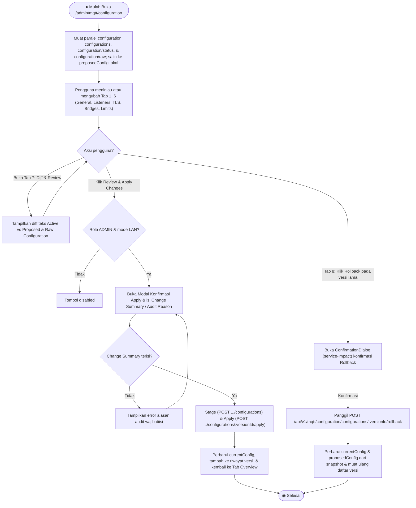

---

## 18. System Health (`/admin/system/health`)

- **Rute**: `/admin/system/health`
- **Komponen**: `src/features/system/SystemHealthPage.tsx`
- **Hak Akses**: Semua role (`ADMIN`, `SUPERVISOR`, `OPERATOR`, `MAINTENANCE`), mode baca saja (LAN & Remote Tunnel)

### Deskripsi & Tujuan
Halaman diagnostik infrastruktur layanan microservice untuk memantau hasil *health probe* secara langsung (`GET /health`) terhadap layanan **API v1**, **TimescaleDB / PostgreSQL**, dan buffer ingest telemetri tanpa menampilkan field runtime yang tidak tersedia di backend (versi Fastify, `pool_active`/`pool_max`, dan `records_per_second`).

### Data yang Disajikan
| Bagian UI | Data / Metrik | Sumber Data | Tujuan Penyajian |
|---|---|---|---|
| **Top KPI Cards** | 4 `MetricCard`: **Overall Health** (status + uptime), **Backend Latency** (ms, label `API v1`), **TimescaleDB Latency** (ms + engine `TimescaleDB / PostgreSQL` tanpa `pool_active`/`pool_max`), **Telemetry Buffer** (`buffer_utilization_pct` tanpa `records_per_second`) | `GET /health` | Pemantauan cepat latensi dan utilisasi buffer sistem |
| **API v1 Backend Service Card** | `Service Status`, `Backend Label` (`API v1`), `Execution Perimeter` | `health.backend` | Informasi diagnostik runtime layanan API |
| **TimescaleDB / PostgreSQL Card** | `Engine Type`, `Query Ping Latency` (ms), `Database Status` | `health.database` | Memantau kesehatan koneksi basis data time-series |

### Activity Diagram Workflow
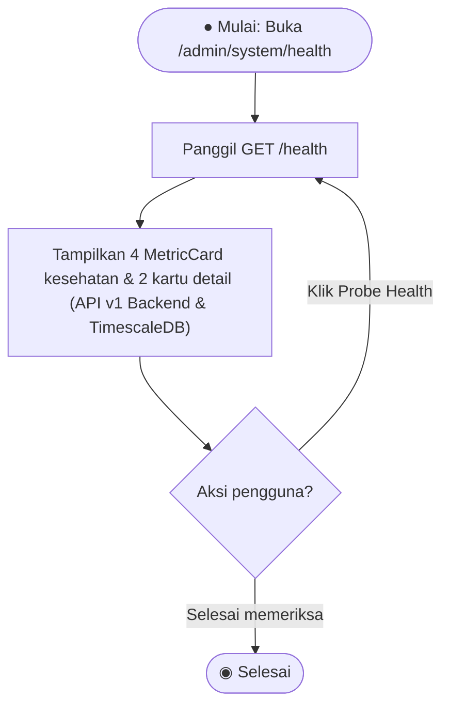

---

## 19. Access Control / IAM (`/admin/access-control`)

- **Rute**: `/admin/access-control` (alias: `/admin/system/access-control`)
- **Komponen**: `src/features/system/AccessControlPage.tsx`
- **Hak Akses**: Khusus `ADMIN` dan hanya muncul di menu pada akses **LAN Pabrik** (`minRole: 'ADMIN', lanOnly: true`); mutasi dinonaktifkan pada Remote Tunnel

### Deskripsi & Tujuan
Konsol tata kelola **Identity & Access Management (IAM)** berbasis **Casbin RBAC/ABAC & Scope Hierarkis** untuk mengelola custom role, katalog permission, penetapan cakupan operator (*Scope Assignments*), aturan policy Casbin (dengan proteksi *anti-lockout* untuk `ADMIN`), serta audit log keputusan otorisasi. Karena endpoint `/access-control/info` tidak tersedia di backend, header halaman menampilkan badge **`AUTHZ MODE: UNAVAILABLE`** dan tidak menyediakan toggle mode/versi palsu.

### Data yang Disajikan
| Bagian UI | Data / Elemen | Sumber Data | Tujuan Penyajian |
|---|---|---|---|
| **Header Governance** | Badge statis **`AUTHZ MODE: UNAVAILABLE`** (metadata mode/versi tidak diekspos backend), tombol `Reload IAM` | State UI (tanpa `/access-control/info`) | Menyatakan secara transparan bahwa metadata mode otorisasi tidak tersedia |
| **Tab 1: Roles** | Tabel role: `Role Identifier` (gembok untuk 4 role sistem), `Privilege Level`, `Classification` (`SYSTEM PROTECTED` / `CUSTOM`), `Description`, tombol hapus khusus custom role | `GET /api/v1/access-control/roles` | Mengelola definisi role sistem dan custom role |
| **Tab 2: Permissions** | Tabel katalog `Action` × `Resource Target Type`, deskripsi, & form tambah permission | `GET /api/v1/access-control/permissions` | Referensi & pendaftaran predikat aksi dan tipe resource yang valid |
| **Tab 3: Scope Assignments** | Tabel penugasan: `Operator` (nama & ID, default `EMP-0115`), `Role`, `Scope Hierarchy` (`ORGANIZATION` s.d. `DEVICE`), `Scope Boundary Target`, tombol hapus | `GET /api/v1/access-control/assignments` | Mengikat operator & role pada batas cakupan hierarki tertentu |
| **Tab 4: Casbin Policies** | Tabel aturan policy: `Rule ID`, `Role Subject`, `Action Predicate`, `Resource Pattern`, `Effect` (`ALLOW`/`DENY`), `Status` (`Active`/`Disabled`), toggle aktif/nonaktif & hapus (terkunci untuk `ADMIN`) | `GET /api/v1/access-control/policies` | Mengatur aturan eksplisit izin atau penolakan Casbin |
| **Tab 5: Decision Audit** | Log keputusan real-time: `Timestamp`, `Subject`, `Decision` (`ALLOW`/`DENY`), `Mode`, `Action`, `Resource Target` | `GET /api/v1/access-control/audit` | Memverifikasi riwayat keputusan otorisasi |

### Activity Diagram Workflow
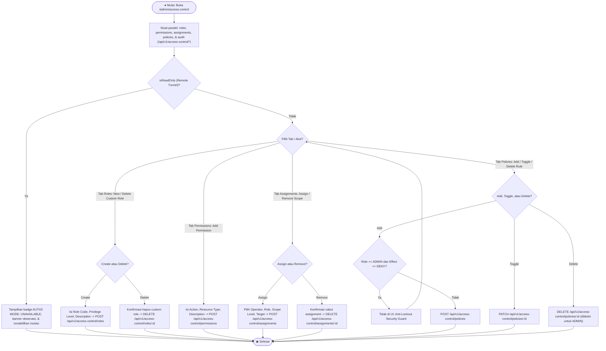

---

## 20. Audit Trail (`/admin/system/audit`)

- **Rute**: `/admin/system/audit`
- **Komponen**: `src/features/system/AuditTrailPage.tsx`
- **Hak Akses**: `ADMIN` & `SUPERVISOR` (mode baca saja, dapat diakses dari LAN & Remote Tunnel)

### Deskripsi & Tujuan
Halaman jejak audit kepatuhan sistem (*immutable compliance audit trail*) yang mencatat seluruh mutasi administratif, perubahan konfigurasi, manajemen keamanan, serta mode jaringan tempat aksi dilakukan (`LAN` vs `REMOTE_TUNNEL`). Seluruh data dimuat dari **`GET /api/v1/access-control/audit`** (menggantikan `/system/audit` yang tidak tersedia di backend).

### Data yang Disajikan
| Bagian UI | Data / Kolom | Sumber Data | Tujuan Penyajian |
|---|---|---|---|
| **Search Bar** | Input pencarian berdasarkan `action`, `details`, `operator_name`, `operator_id`, atau `resource_id` | Filter lokal | Menelusuri aktivitas administrator atau resource tertentu |
| **Tabel Audit Trail** | `Timestamp`, `Action` (kode aksi mono), `Resource Target` (`resource_type` & `resource_id`), `Operator` (`operator_name` & `operator_id`), `Audit Details`, `Access Mode` (`LAN`/`REMOTE_TUNNEL`) | `GET /api/v1/access-control/audit` | Menyajikan catatan kronologis mutasi sistem secara transparan |

### Activity Diagram Workflow
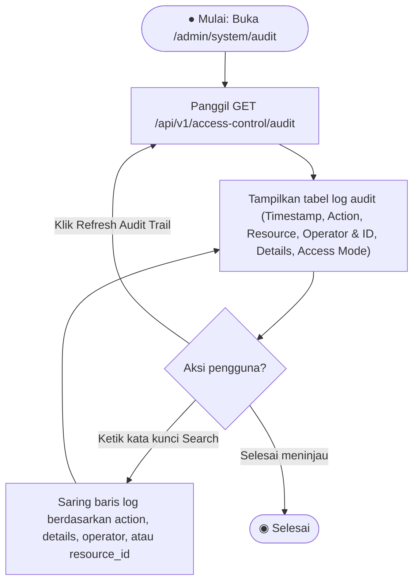

---

## 21. System Information (`/admin/system/info`)

- **Rute**: `/admin/system/info`
- **Komponen**: `src/features/system/SystemInfoPage.tsx`
- **Hak Akses**: Semua role (`ADMIN`, `SUPERVISOR`, `OPERATOR`, `MAINTENANCE`), halaman referensi statis

### Deskripsi & Tujuan
Halaman referensi arsitektur teknis, topologi multi-lapisan IIoT, batas keamanan jaringan (*Dual-VHost*), serta standar rumus perhitungan OEE (**TPM Six Big Losses**) yang digunakan di seluruh platform. Tujuannya adalah menjadi dokumentasi internal yang selalu tersedia di dalam aplikasi bagi tim teknis, supervisor, dan auditor.

### Data yang Disajikan
| Bagian UI | Data / Konten | Sumber Data | Tujuan Penyajian |
|---|---|---|---|
| **Multi-Tier IIoT Architecture** | Penjelasan 4 lapisan: **1. Edge Layer** (ESP32-S3 FreeRTOS, Modbus RTU/TCP, MQTT TLS), **2. Transport Layer** (Mosquitto 2.0 + Dynamic Security), **3. Backend Ingestion** (API v1 + TimescaleDB + WebSocket), **4. Administration UI** (React SPA + role guards) | Konten referensi statis | Menjelaskan alur teknis sistem dari edge ke UI |
| **Dual-VHost Network Security Boundary** | Penjelasan segmentasi **Local Factory LAN (VHost 1)** vs **Remote Cloud Tunnel (VHost 2)** yang memblokir metode mutasi pada Nginx reverse proxy | Konten referensi statis | Memperjelas alasan pembatasan fitur saat diakses secara remote |
| **OEE Calculation Standards** | Formula matematis & penjelasan rugi untuk **Availability (%)**, **Performance (%)**, dan **Quality (%)** sesuai TPM Six Big Losses | Konten referensi statis | Menyamakan pemahaman standar kalkulasi metrik OEE antar pengguna |

### Activity Diagram Workflow
```mermaid
flowchart TD
    Start(["● Mulai: Buka /admin/system/info"]) --> RenderRef["Tampilkan kartu Arsitektur Multi-Tier IIoT, Batas Keamanan Dual-VHost, & Standar Formula OEE"]
    RenderRef --> End(["◉ Selesai: Pengguna selesai membaca referensi"])
```
