# Dokumentasi Halaman & Workflow (Activity Diagram) — OEE IIoT Admin Panel

Dokumen ini berisi dokumentasi lengkap seluruh halaman (**25 halaman**: 21 halaman
asli + 4 tambahan E20) pada aplikasi **OEE IIoT Admin Panel** beserta rute, hak akses, deskripsi, tujuan, rincian data yang disajikan, aturan keamanan/guard, serta **Activity Diagram** workflow masing-masing halaman berdasarkan implementasi aktual codebase.

> **Pembaruan 19 Nov 2026 (E20 + E21):** dokumen ini disinkronkan ulang terhadap
> `src` saat ini (routes `src/app/Router.tsx`) dan api_docs terupdate
> (`~/workspace/user/files/pasted-text.txt`) — lihat `docs/API_SYNC_DIFF.md`,
> `docs/BACKEND_SYNC_CLOSURE.md`, `AUDIT.md` §24–§25. Halaman baru: **§22
> Force Change Password (`/force-change-password`)**, **§23 Production Lines
> (`/admin/lines`)**, **§24 Shifts (`/admin/shifts`)**, **§25 Shift Schedules
> (`/admin/shift-schedules`)**. Perubahan isi E20 pada halaman lama: Login
> (tanpa lockout lokal — throttle server 5/60s + `Retry-After`); Work Orders
> (status `PENDING_CLOSE`, dispatch/complete HMI-only, cancel ADMIN);
> Operational Events (tanpa `severity`, enum `event_type` 32, ack note max
> 1000, list global); Devices (provision kanonis/revoke/rotasi kredensial);
> Operators (role string bebas, default `UNASSIGNED`); System Health
> (`GET /health/detail`); Access Control (`/access-control/info` dibaca,
> hanya ADMIN immutable, `POST /permissions` didukung); Audit Trail (sumber
> `GET /system/audit` + ekspor); Broker Config (apply/rollback 202 +
> polling); Dynamic Security (tanpa modal provision); Broker Overview
> (status `READY`, count `null`).
>
> **Pembaruan 19 Nov 2026 (uji mutasi E2E, E26):** catatan status hasil uji
> mutasi end-to-end panel vs API live (35 mutasi lolos, 0× 403, SISA kosong;
> lihat `AUDIT.md` §35 dan `docs/E2E_MUTATION_TEST.md`) disisipkan per
> halaman: §3 Work Orders, §4 Downtime, §5 Operational Events, §7 Devices,
> §8 Machines, §9 Products, §10 Operators, §14 Data Reconciliation,
> §16 Dynamic Security, §17 Broker Configuration, §19 Access Control,
> §20 Audit Trail.

---

## Daftar Isi

1. **Autentikasi**
   - [1. Login (`/login`)](#1-login-login)
2. **Overview**
   - [2. Overview Dashboard (`/admin`)](#2-overview-dashboard-admin)
3. **Production & Monitoring**
   - [3. Work Orders (`/admin/work-orders`)](#3-work-orders-adminwork-orders)
   - [4. Downtime Events (`/admin/downtime`)](#4-downtime-events-admindowntime)
   - [5. Operational Events (`/admin/audit`)](#5-operational-events-adminaudit)
   - [6. Live Machine State (`/admin/live-state`)](#6-live-machine-state-adminlive-state)
4. **Assets**
   - [7. Edge Devices (`/admin/devices`)](#7-edge-devices-admindevices)
   - [8. Machines (`/admin/machines`)](#8-machines-adminmachines)
   - [9. Products (`/admin/products`)](#9-products-adminproducts)
   - [10. Operators (`/admin/operators`)](#10-operators-adminoperators)
5. **Data & Analytics**
   - [11. Telemetry History (`/admin/telemetry`)](#11-telemetry-history-admintelemetry)
   - [12. Shift Analytics / OEE Analytics (`/admin/shift-analytics`)](#12-shift-analytics--oee-analytics-adminshift-analytics)
   - [13. Quality & Rejects (`/admin/quality`)](#13-quality--rejects-adminquality)
   - [14. Data Reconciliation (`/admin/reconciliation`)](#14-data-reconciliation-adminreconciliation)
6. **MQTT & Connectivity**
   - [15. Broker Overview (`/admin/mqtt/overview`)](#15-broker-overview-adminmqttoverview)
   - [16. Dynamic Security (`/admin/mqtt/security`)](#16-dynamic-security-adminmqttsecurity)
   - [17. Broker Configuration Manager (`/admin/mqtt/configuration`)](#17-broker-configuration-manager-adminmqttconfiguration)
7. **System**
   - [18. System Health (`/admin/system/health`)](#18-system-health-adminsystemhealth)
   - [19. Access Control / IAM (`/admin/access-control`)](#19-access-control--iam-adminaccess-control)
   - [20. Audit Trail (`/admin/system/audit`)](#20-audit-trail-adminsystemaudit)
   - [21. System Information (`/admin/system/info`)](#21-system-information-adminsysteminfo)
8. **Halaman tambahan (E20)**
   - [22. Force Change Password (`/force-change-password`)](#22-force-change-password-force-change-password)
   - [23. Production Lines (`/admin/lines`)](#23-production-lines-adminlines)
   - [24. Shifts (`/admin/shifts`)](#24-shifts-adminshifts)
   - [25. Shift Schedules (`/admin/shift-schedules`)](#25-shift-schedules-adminshift-schedules)

---

## Arsitektur Shell Global (Berlaku di Semua Halaman `/admin/*`)

Seluruh halaman di bawah `/admin/*` dibungkus oleh `AdminLayout` yang menyediakan:
- **NetworkModeBanner**: Indikator perimeter jaringan (**LAN Pabrik** penuh vs **Remote Tunnel** read-only). Pada mode Remote Tunnel (`isReadOnly = true`), seluruh aksi mutasi dinonaktifkan di lapisan UI. Nilai mode/kanal diambil dari server (`GET /api/v1/system/access-mode`) bila tersedia, fallback derivasi env+kanal (E20 P20.5).
- **Sidebar**: Navigasi berbasis role (`ADMIN`, `SUPERVISOR`, `OPERATOR`, `MAINTENANCE`) dan perimeter jaringan (`lanOnly`).
- **Topbar**: Navigasi cepat, status koneksi MQTT & TimescaleDB, indikator sisa masa berlaku sesi JWT (`sessionTtlRemaining` dengan peringatan bila `< 3 menit`), toggle tema (Light/Dark), info pengguna aktif, dan tombol Logout. **Tidak ada pemilih role langsung** — ganti role hanya lewat logout → login sebagai operator lain (aturan env audit 2026-11-16).
- **Breadcrumbs**: Penunjuk hierarki lokasi halaman aktif.

---

## 1. Login (`/login`)

- **Rute**: `/login`
- **Komponen**: `src/features/auth/LoginPage.tsx`
- **Hak Akses**: Publik (umumnya diakses dari LAN Pabrik)

### Deskripsi & Tujuan
Halaman gerbang autentikasi terpusat bagi seluruh personel pabrik (`ADMIN`, `SUPERVISOR`, `OPERATOR`, `MAINTENANCE`) untuk masuk ke dalam Admin Panel menggunakan kredensial ID Operator/NIK dan password (menggantikan mekanisme PIN lama). Tujuannya adalah memastikan hanya personel terotorisasi yang memperoleh sesi akses ke konsol manajemen IIoT. **Throttle login hanya dari server** (rate limit 5 kali percobaan gagal per 60 detik + header `Retry-After`) — **panel TIDAK menerapkan lockout lokal paralel** (E20 P20.3, §L api_docs). Bila login mengembalikan flag `mustChangePassword`, pengguna diarahkan ke `/force-change-password` (§22) sebelum masuk dashboard.

### Data yang Disajikan
| Bagian UI | Data / Elemen | Keterangan |
|---|---|---|
| Header & Identitas | Logo `OE`, judul `OEE ADMIN PANEL`, subtitle sistem, badge perimeter `LAN Pabrik (192.168.1.105)` | Menunjukkan konteks sistem dan jaringan aktif |
| Form Autentikasi | Input `ID Operator / NIK` (contoh `ADM-001`), input `Password` (dengan toggle tampil/sembunyi), input opsional `ID Stasiun / Terminal` (misal `STATION-01`) | Kredensial untuk `POST /api/v1/auth/login` |
| Panel Feedback & Throttle Server | Pesan error inline (`401` atau validasi kosong), banner countdown throttle server (`429` + `Retry-After`, sisa detik dari server) | Throttle hanya dari server (5/60s); tanpa lockout lokal — tombol submit diblokir selama `retryAfterSec > 0` |
| Profil Uji Cepat | 4 tombol preset (`ADM-001` Admin Pabrik, `EMP-0042` Supervisor, `EMP-0115` Operator, `EMP-0208` Maintenance) | **Hanya bila env demo mengizinkan** (`VITE_DEMO_PRESET_LOGIN`); tidak dirender di env real — login wajib isi Operator ID + password sendiri |
| Footer Keamanan | Versi build (`v1.0.0-prod (Build 2026.11) · ISO 22400 OEE Engine`) & notice audit trail | Informasi versi dan pemberitahuan pencatatan audit |

### Activity Diagram Workflow
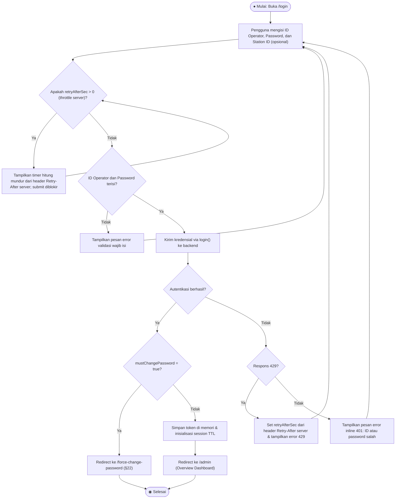

---

## 2. Overview Dashboard (`/admin`)

- **Rute**: `/admin`
- **Komponen**: `src/features/overview/OverviewPage.tsx`
- **Hak Akses**: Semua role (`ADMIN`, `SUPERVISOR`, `OPERATOR`, `MAINTENANCE`), mode baca tersedia di LAN & Remote Tunnel

### Deskripsi & Tujuan
Halaman ringkasan eksekutif (*command center* read-only) yang menyajikan potret kesehatan infrastruktur IIoT, status armada mesin/perangkat secara real-time, antrean insiden downtime aktif, serta event operasional terbaru dalam satu layar. Tujuannya adalah membantu supervisor, admin, dan tim IT/OT memindai kondisi pabrik secara cepat dan menavigasi langsung ke modul terkait tanpa melakukan mutasi berisiko dari layar ringkasan.

### Data yang Disajikan
| Bagian UI | Data / Metrik | Sumber Data | Tujuan Penyajian |
|---|---|---|---|
| **Section A: Core Infrastructure Health** | Status & latensi **API v1** (status, ms, uptime — tanpa versi Fastify), **Time-Series Database** (TimescaleDB/PostgreSQL, ms — tanpa metrik pool koneksi), **MQTT Mosquitto** (`Mosquitto 2.0.x`, status Dynamic Security, jumlah active clients), **WebSocket Stream** (`/ws/telemetry`, status Live Relay, jumlah active listeners), serta utilisasi **Telemetry Buffer (%)** (tanpa `records/sec`) | `GET /health` | Memantau kesehatan 4 pilar layanan backend & ingest data |
| **Section B: Production Overview KPIs** | 4 `MetricCard`: **Registered Devices** (total, online vs offline), **Registered Machines** (total, jumlah terikat ESP32), **Active Work Orders** (jumlah `ACTIVE` & `PENDING`), **Active Downtimes** (jumlah insiden aktif yang butuh klasifikasi) | `GET /api/v1/devices`, `GET /api/v1/machines`, `GET /api/v1/work-orders`, `GET /api/v1/downtime-events/active` | Ringkasan kuantitatif aset dan beban operasional aktif |
| **Section C: Fleet OEE Snapshot** | Rata-rata **Overall OEE (%)**, **Availability (%)**, **Performance (%)**, **Quality Rate (%)** dari mesin non-offline + **Tabel Live Armada** (Machine, Bound Device, FSM State badge, OEE %, Produced Good/Defect, Active Order) | `GET /api/v1/live-state` | Membandingkan performa live tiap mesin sekaligus mengarahkan ke Shift Analytics |
| **Section D: Recent Operational Events** | 4 event terbaru dari list global: tipe event (enum `event_type` kanonis 32 nilai), nama mesin, pesan, timestamp, dan status acknowledgement (`Ack'd` / `Unacknowledged`) — **tanpa badge severity** (skema FR-034-01 tidak mengenal `severity`) | `GET /api/v1/operational-events?limit=5` (list global; bukan agregasi per-device) | Memberi visibilitas alarm/kejadian terkini dan tautan ke Operational Events |
| **Section E: Quick Administrative Actions** | Daftar tautan cepat ke Create Work Order, Register Edge Device, Bind Device to Machine, Manage MQTT Dynamic Security, dan Mosquitto Configuration Manager | Navigasi statis | Mempercepat akses ke modul administratif utama |

### Activity Diagram Workflow
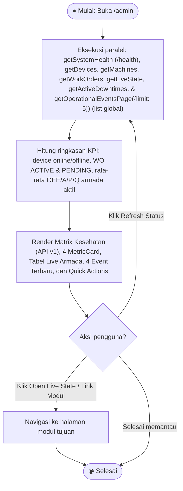

---

## 3. Work Orders (`/admin/work-orders`)

- **Rute**: `/admin/work-orders` (alias: `/admin/production/work-orders`)
- **Komponen**: `src/features/production/WorkOrdersPage.tsx`, `src/features/production/WorkOrderWizardModal.tsx`
- **Hak Akses**: Baca semua role; Cancel (`ADMIN` di LAN). **Dispatch & Complete adalah aksi HMI lantai produksi — panel tidak mengeksposnya.**

### Deskripsi & Tujuan
Halaman administrasi siklus hidup (*lifecycle*) perintah kerja produksi (Work Order): pemantauan status, validasi konteks 4-Zone, hingga pembatalan (*cancel*). Pembuatan dan dispatch Work Order dilakukan di **HMI lantai produksi**; panel menampilkan status dan menyediakan cancel. Tujuannya adalah menjamin setiap batch produksi tercatat lengkap untuk kalkulasi OEE, dengan status kanonis `PENDING` / `ACTIVE` / `PENDING_CLOSE` / `COMPLETED` / `ABORTED` (§C api_docs).

### Data yang Disajikan
| Bagian UI | Data / Kolom | Sumber Data | Tujuan Penyajian |
|---|---|---|---|
| **Filter Toolbar** | Pencarian teks (WO#, Produk, Mesin, Operator), filter dropdown **Status** (`ALL`, `PENDING`, `ACTIVE`, `PENDING_CLOSE`, `COMPLETED`, `ABORTED`), filter dropdown **Machine** | State lokal atas daftar WO & mesin | Mempermudah pencarian dan penyaringan batch produksi |
| **Tabel Work Orders** | `Order Number` (mono), `Product` (nama & ID), `Machine` (nama & ID), `Operator & Shift`, `Progress / Target` (completed/target pcs, persentase, progress bar), `Status` (badge warna), `Actions` (Cancel sesuai status & role; `PENDING_CLOSE` ditandai sebagai menunggu konfirmasi penutupan) | `GET /api/v1/work-orders`, `GET /api/v1/products`, `GET /api/v1/machines`, `GET /api/v1/devices`, `GET /api/v1/operators` | Memantau progres dan mengendalikan pembatalan tiap Work Order |
| **Banner Batas HMI** | Pemberitahuan bahwa pembuatan dan dispatch Work Order dilakukan di HMI lantai produksi; master data yang telah dihapus tetap tampil sebagai `[dihapus]` | Teks statis halaman | Menjelaskan pembagian tugas panel vs HMI |
| **Modal Detail Work Order** | Detail WO (produk, mesin, operator, shift, progres, status) + pratinjau resolusi konteks 4-Zone (`Parameter Kesiapan Produksi`) dengan pilihan `device_id` | `GET /api/v1/work-orders/:wo_id/resolve` (`device_id` wajib) | Memeriksa kesiapan produksi satu WO tanpa mutasi |
| **Dialog Cancel** | Ringkasan dampak batch; input alasan pembatalan (`<= 500` karakter) pada Cancel (`ABORTED`); berlaku dari `PENDING`/`ACTIVE`/`PENDING_CLOSE` | Input pengguna & konteks WO | Menjamin konfirmasi eksplisit dan pencatatan audit pembatalan |

### Activity Diagram Workflow
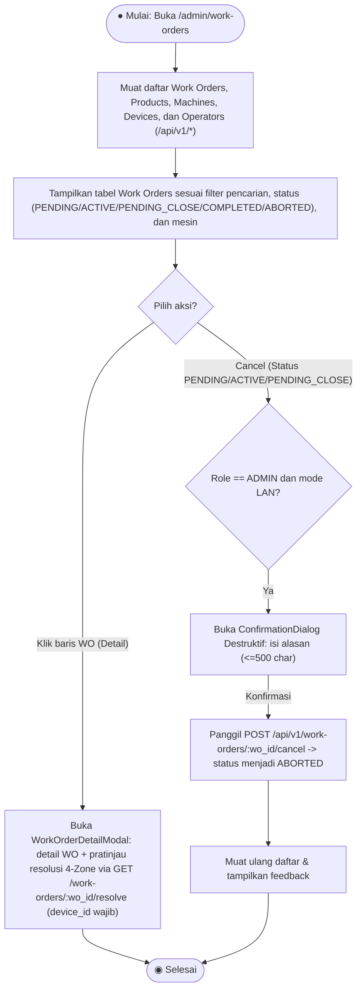

> **Status uji mutasi E2E — 19 Nov 2026** (`AUDIT.md` §35,
> `docs/E2E_MUTATION_TEST.md` L45/L41): **Cancel terverifikasi live** —
> `WO-SIM-20260906-02` (PENDING, WO simulasi, bukan WO-001) dibatalkan
> menjadi `ABORTED` (irreversibel, perubahan permanen yang diterima).
> **Resolve-preview BELUM teruji** — panel kesiapan produksi tidak muncul
> karena controller `STM32-OEE-SIM` offline ("Pemeriksaan Parameter Belum
> Tersedia — Edge controller STM32-OEE-SIM is currently offline..."),
> perilaku informatif, bukan bug.

---

## 4. Downtime Events (`/admin/downtime`)

- **Rute**: `/admin/downtime` (alias: `/admin/monitoring/downtime`)
- **Komponen**: `src/features/monitoring/DowntimeEventsPage.tsx`, `src/features/monitoring/DowntimeReasonModal.tsx`
- **Hak Akses**: Semua role dapat membaca & melihat antrean; pelabelan/ekspor mengikuti izin role & mode jaringan (LAN untuk mutasi; ekspor khusus `ADMIN`/`SUPERVISOR`)

### Deskripsi & Tujuan
Halaman administrasi kejadian berhentinya mesin (*stoppage*), mencakup antrean insiden downtime yang sedang berlangsung (*live*), grafik Pareto distribusi kategori downtime, riwayat insiden hingga retensi 90 hari dengan paginasi cursor, pelabelan akar masalah berbasis 10 kategori TPM kanonis & *Six Big Losses*, serta ekspor data historis (CSV/NDJSON/JSON). Tujuannya adalah memastikan seluruh downtime terklasifikasi untuk analisis perbaikan keandalan mesin dan perhitungan rugi Availability/Performance.

### Data yang Disajikan
| Bagian UI | Data / Kolom | Sumber Data | Tujuan Penyajian |
|---|---|---|---|
| **HistoricalExportToolbar** | Preset rentang waktu (`24 Jam`, `7 Hari`, `30 Hari`, `90 Hari`, `Kustom`), tombol ekspor `CSV` / `NDJSON` / `JSON`, metadata hasil ekspor (`X-Export-*`), dan error retensi (`RETENTION_EXCEEDED` / `403`) | Context user & konfigurasi retensi (90 hari) | Mengatur jendela waktu kueri dan mengunduh data historis |
| **Active Downtimes Highlight Strip** | Daftar insiden aktif: nama mesin, status label (`Perlu alasan` / `Terlabeli`), alasan saat ini, durasi berjalan, waktu mulai, tombol `Beri Alasan` / `Ubah Label` | `GET /api/v1/downtime-events/active` | Menyorot mesin yang sedang berhenti agar segera ditindaklanjuti |
| **Chart Pareto Kategori Downtime** | Ranking 10 kategori TPM kanonis: durasi total, jumlah insiden, persentase dampak, persentase kumulatif, indikator `80/20 Key` | Kalkulasi atas dataset downtime termuat | Mengidentifikasi penyebab downtime paling dominan (prinsip 80/20) |
| **Filter Toolbar & Tabel Histori** | Filter server: Perangkat & `unlabeled_only`; Filter lokal: Kategori (10 enum TPM). Kolom tabel: `Mesin & Perangkat` (`[dihapus]` jika historis), `Kategori TPM & Six Big Losses` (pilar OEE), `Akar Masalah (Reason)`, `Durasi`, `Waktu Mulai / Selesai`, `Operator / Status`, `Aksi` (`Label`) | `GET /api/v1/downtime` (paginasi cursor) & `mapDowntimeToSixBigLoss()` | Audit mendetail seluruh catatan henti mesin historis |
| **CursorPaginationBar** | Jumlah rekaman dimuat vs total, `next_cursor`, pemilih `Per halaman` (`10`/`20`/`50`), tombol `Muat Lebih Banyak` & `Halaman Awal` | Metadata paginasi server | Navigasi dataset besar tanpa membebani memori |
| **DowntimeReasonModal** | Pilihan 10 kategori TPM, textarea deskripsi akar masalah & tindakan korektif, waktu mulai & selesai insiden | Event downtime terpilih | Mengklasifikasikan atau memperbarui alasan downtime (`POST /api/v1/downtime-events/:id/reason`) |

### Activity Diagram Workflow
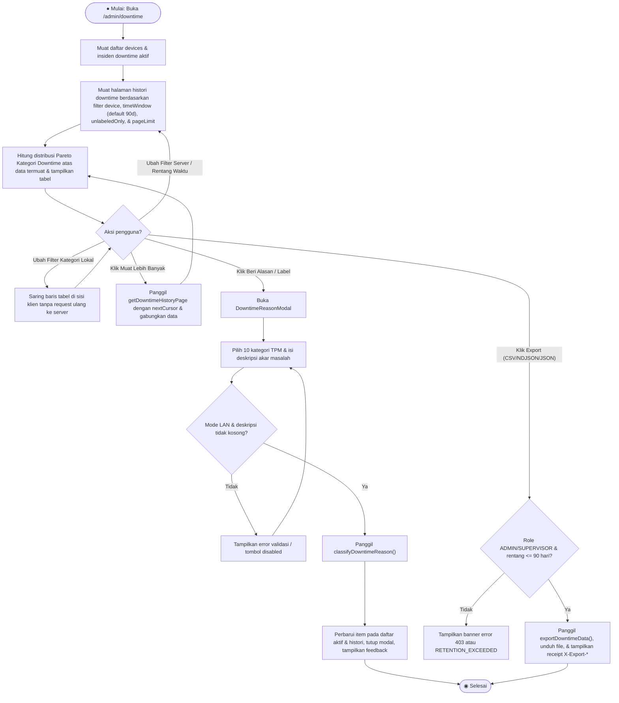

> **Status uji mutasi E2E — 19 Nov 2026** (`AUDIT.md` §35,
> `docs/E2E_MUTATION_TEST.md` L43/C1): overwrite label terverifikasi
> (kategori `OTHER`, alasan "E2E-TEST overwrite label"). **MUT-04
> (panel, Low — FAT-230):** modal overwrite tidak punya opsi "Belum
> dikategorikan" dan selalu memberi prefix kategori, sehingga teks asli
> "Equipment failure" tidak bisa dikembalikan persis; cleanup
> mengembalikan kategori `EQUIPMENT_FAILURE` + alasan "Equipment
> failure" → baris kini "[EQUIPMENT_FAILURE] Equipment failure"
> (residu yang diterima, kolom kategori tetap "Belum dikategorikan").
> **Label baru pada event unlabeled BELUM teruji** — tidak ada event
> unlabeled saat uji (STM32-OEE-01: 2 event historis, keduanya sudah
> berlabel; STM32-OEE-SIM: 0 event).

---

## 5. Operational Events (`/admin/audit`)

- **Rute**: `/admin/audit` (alias: `/admin/monitoring/events`)
- **Komponen**: `src/features/monitoring/OperationalEventsPage.tsx`
- **Hak Akses**: Semua role dapat membaca & memfilter; tombol `Acknowledge` diblokir pada mode Remote Tunnel; ekspor khusus `ADMIN`/`SUPERVISOR`

### Deskripsi & Tujuan
Halaman aliran kejadian operasional (*operational event stream*) dari list global `GET /api/v1/operational-events` (bila scope "Semua Perangkat") atau per perangkat `GET /api/v1/operational-events/:deviceId`, yang merekam alarm mesin, transisi FSM, eksekusi perintah, pemutusan koneksi (*disconnect*), dan *heartbeat timeout*, dilengkapi mekanisme **Acknowledgement** oleh operator/supervisor serta fitur ekspor. Skema item mengikuti FR-034-01 persis: **tanpa field `severity`** dan tanpa `machine_name` karangan (`machineName` bernilai `null` bila mesin sudah dihapus). Tujuannya adalah memastikan setiap anomali atau alarm operasional ditanggapi, dicatat siapa penanggung jawabnya beserta catatan tindak lanjut, dan dapat diekspor untuk investigasi.

### Data yang Disajikan
| Bagian UI | Data / Kolom | Sumber Data | Tujuan Penyajian |
|---|---|---|---|
| **HistoricalExportToolbar** | Preset waktu (`24 Jam` s.d. `90 Hari` / `Kustom`), label cakupan (`Mode: Global (/api/v1/operational-events)` vs `Per-Device`), tombol ekspor `CSV` / `NDJSON` / `JSON`, serta receipt/error ekspor | Context & state filter | Mengatur rentang waktu & mengekspor log event operasional (ekspor global hanya kirim `from, to, format, limit` — tanpa `machine_id`/`event_type`) |
| **Filter Toolbar** | Dropdown `Scope Perangkat` (`Semua Perangkat` = list global, atau per `device_id`), dropdown `Event Type` (enum kanonis **32 nilai** + pola `COMMAND_<cmd>_DISPATCHED` / `MQTT_ADMIN_<op>` / `DEVICE_EVENT_<n>`), dropdown `Acknowledged` (`ALL`/`ACK`/`UNACK`), counter jumlah termuat vs total | `GET /api/v1/devices` & state filter | Memfokuskan inspeksi pada perangkat, tipe event, dan status ack tertentu |
| **Tabel Operational Events** | `Type` (jenis event, tanpa kolom severity), `Target Machine` (nama mesin & `device_id`), `Message / Payload` (`description`), `Timestamp` (`recordedAt`), `Status & Ack By` (`Acknowledged` + nama operator atau `Unacknowledged`), `Action` (`Acknowledge` / `Resolved`) | `GET /api/v1/operational-events` (global) atau `/:deviceId` (paginasi cursor) | Menampilkan kronologi kejadian operasional dan status penanganannya |
| **ConfirmationDialog Acknowledge** | Info mesin & tipe event, isi pesan event, daftar dampak audit, textarea `Acknowledgement Note` (opsional, maks. **1000** karakter) | `PATCH /api/v1/operational-events/:id/ack` (body hanya `{note?}`; aktor dari JWT) | Mencatat pengakuan alarm secara resmi ke jejak audit |

### Activity Diagram Workflow
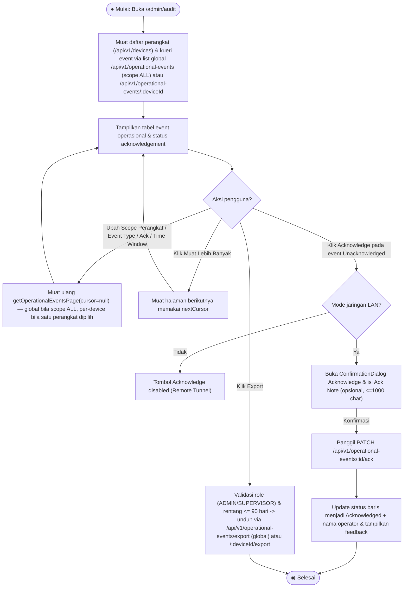

> **Status uji mutasi E2E — 19 Nov 2026** (`AUDIT.md` §35,
> `docs/E2E_MUTATION_TEST.md` L42): **Acknowledge terverifikasi live** —
> event 1148 (`SECURITY_REJECTION` / `PERIMETER_GATEWAY`,
> 11/19/2026 4:20:44 PM) di-ack oleh ADM-001 dengan catatan "E2E-TEST
> ack — verifikasi uji mutasi" (terverifikasi di filter "Sudah Ack",
> 7:05:45 PM; tanpa banner sukses, sesuai ekspektasi; ack tidak bisa
> di-undo dari UI — perubahan permanen yang diterima).

---

## 6. Live Machine State (`/admin/live-state`)

- **Rute**: `/admin/live-state` (alias: `/admin/monitoring/live-state`)
- **Komponen**: `src/features/monitoring/LiveStatePage.tsx`
- **Hak Akses**: Semua role (`ADMIN`, `SUPERVISOR`, `OPERATOR`, `MAINTENANCE`), mode baca saja (LAN & Remote Tunnel)

### Deskripsi & Tujuan
Konsol pemantauan keadaan mesin secara langsung (*live*) yang melakukan polling berkala setiap 10 detik (serta mendukung penyegaran manual) untuk menampilkan state FSM terbaru, indeks OEE real-time, jumlah produk baik/cacat, durasi jalan/henti, dan batch aktif pada setiap mesin. Tujuannya adalah memberikan visibilitas lantai produksi secara cepat bagi tim pengawas tanpa menyediakan tombol aktuasi mesin di Admin Panel.

### Data yang Disajikan
| Bagian UI | Data / Kolom | Sumber Data | Tujuan Penyajian |
|---|---|---|---|
| **Filter Bar** | Input pencarian (Nama Mesin, Device ID, atau Work Order aktif) & dropdown filter `FSM State` (`ALL`, `RUNNING`, `READY`, `DOWNTIME`, `OFFLINE`) | State filter lokal | Menyaring mesin berdasarkan status operasi atau batch |
| **Tabel Live Machine State** | `Machine & Device` (nama mesin & `device_id`), `FSM State` (`MachineStateBadge` dengan ikon + warna), `OEE Index` (kode warna >=85% hijau, >=70% biru, >0% amber), `Avail · Perf · Qual` (%), `Parts (Good / Rej)`, `Run / Down Time` (format durasi), `Active Batch` (nomor WO & produk atau `Idle / No Order`) | `GET /api/v1/live-state` (auto-polling tiap 10 detik) | Memantau performa dan status aktual tiap mesin secara real-time |

### Activity Diagram Workflow


---

## 7. Edge Devices (`/admin/devices`)

- **Rute**: `/admin/devices` (alias: `/admin/assets/devices`)
- **Komponen**: `src/features/assets/DevicesPage.tsx`, `src/features/assets/components/DeviceHealthDrawer.tsx`
- **Hak Akses**: Semua role dapat membaca & membuka drawer diagnostik; pendaftaran perangkat baru diblokir di Remote Tunnel (`isReadOnly`)

### Deskripsi & Tujuan
Halaman registri perangkat kontroler edge (ESP32-S3 / STM32) yang mencatat identitas jaringan, versi firmware, status kehadiran (*presence* `ONLINE`/`OFFLINE`), mesin yang terikat, dan waktu telemetri terakhir, serta menyediakan panel samping **Device Health Drawer** untuk diagnostik cache Redis & FreeRTOS perangkat keras. **Provisioning kanonis** (E20, spec 015): `POST /api/v1/devices/provision` — satu aksi membuat identitas broker + baris registry, password dibuat backend dan kredensial hanya ditampilkan sekali. Registrasi manual `POST /api/v1/devices` tetap ada sebagai **legacy** (berlabel di UI). Tujuannya adalah mengelola inventaris node IoT lapangan dan memverifikasi kesehatan memori (`heapFree`) serta *task* RTOS pada setiap perangkat.

### Data yang Disajikan
| Bagian UI | Data / Kolom | Sumber Data | Tujuan Penyajian |
|---|---|---|---|
| **Search Toolbar** | Pencarian berdasarkan Serial Number, IP Address, MAC Address, atau Bound Machine | Filter lokal | Menemukan unit kontroler edge tertentu dengan cepat |
| **Tabel Edge Devices** | `Serial Number` (mono), `Network Coordinates` (IP & MAC Address), `Firmware`, `Presence State` (`ONLINE`/`OFFLINE` dengan indikator titik & warna), `Bound Machine` (nama mesin atau `Unbound`), `Enrollment` (`enrollmentState` `PROVISIONED`/`ACTIVE`/`REVOKED` + tanggal provision/rotasi kredensial), `Last Telemetry` (timestamp), `Diagnostics` (tombol buka drawer) | `GET /api/v1/devices` | Pemantauan kesiapan konektivitas dan pemetaan aset IoT |
| **Modal Provision Device (kanonis)** | Form input: `Device ID`, `Machine` (opsional, bind langsung), `Model` (opsional); diikuti tampilan **Kredensial Sekali Tampil** `{username, password, clientId, topicPrefix}` (password 32 char dibuat backend; di-wipe saat modal ditutup) | `POST /api/v1/devices/provision` | Menambah perangkat lengkap dengan identitas broker (spec 015, ADR-009) |
| **Modal Register Edge Device (legacy)** | Form input: `Hardware Serial Number`, `MAC Address`, `Static IP Address`, `Firmware Version` — berlabel legacy di UI ("gunakan Provision untuk alur lengkap") | Input admin (`POST /api/v1/devices`) | Mendaftarkan identitas hardware baru tanpa kredensial broker |
| **DeviceDetailModal — Revoke & Rotasi Kredensial** | Tombol `Revoke` (alasan wajib 1..200 karakter) dan `Rotasi Kredensial` (`force` + alasan; guard 409 `DEVICE_IN_PRODUCTION` bila WO aktif tanpa `force`); hasil rotasi tampil sebagai kredensial sekali tampil | `POST /api/v1/devices/:deviceId/revoke`, `POST /api/v1/devices/:deviceId/credentials` | Mencabut identitas perangkat atau memutar kredensial brokernya |
| **DeviceHealthDrawer** | Identitas & binding perangkat; metrik **Heap Free** (`heapFree` bytes), **RTOS Tasks** (`tasksHealthy / tasksTotal`), **Cache Age** (`ageSec` detik — menangani *cache miss* `ageSec >= 999999`), **Stale Count** (`staleCount`), **Stale Tasks** (`staleTasks`), dan **Event Flags** (`eventFlags`) tanpa field `wifi_rssi` atau `uptime_sec` | `GET /api/v1/devices/:id/health` | Diagnostik kesehatan internal RTOS dari cache backend secara jujur tanpa data sintetis |

### Activity Diagram Workflow
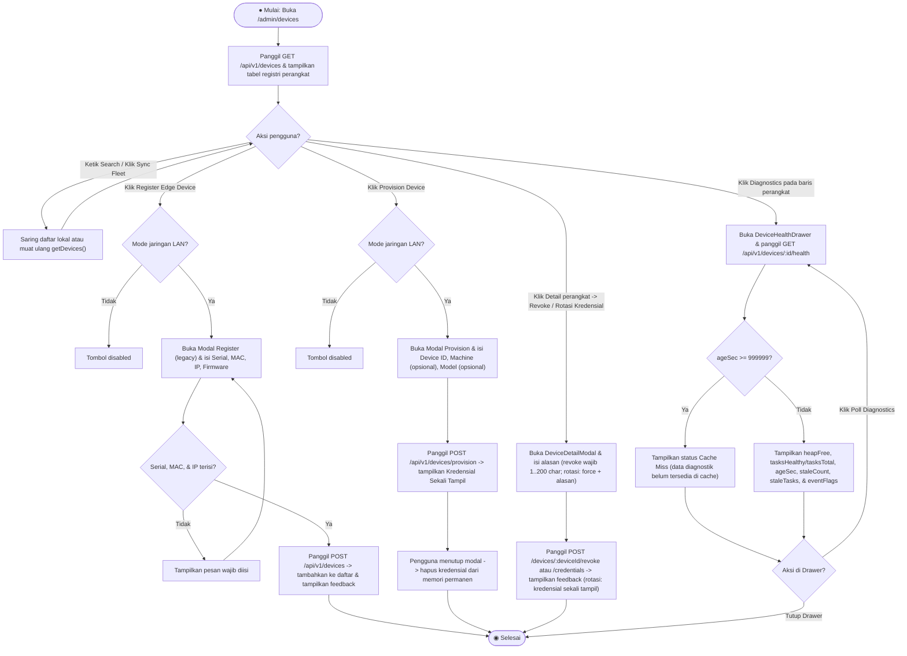

> **Status uji mutasi E2E — 19 Nov 2026** (`AUDIT.md` §35,
> `docs/E2E_MUTATION_TEST.md` L3–L4, L7, L14–L15): **terverifikasi
> live** — provision kanonis `STM32-OEE-TEST01` (kredensial sekali
> tampil disalin sebelum dialog ditutup), register legacy
> `STM32-OEE-TEST02`, edit device (IP + firmware), rotasi kredensial,
> revoke kredensial, dan delete kedua device uji (cleanup C9–C10).
> Observasi (bukan tiket): baris device hasil register legacy berbadge
> `PROVISIONED`, bukan `ACTIVE` seperti ekspektasi rencana.

---

## 8. Machines (`/admin/machines`)

- **Rute**: `/admin/machines` (alias: `/admin/assets/machines`)
- **Komponen**: `src/features/assets/MachinesPage.tsx`
- **Hak Akses**: Semua role dapat membaca; pendaftaran mesin serta operasi Bind/Unbind diblokir di Remote Tunnel (`isReadOnly`)

### Deskripsi & Tujuan
Halaman master aset mesin fisik produksi (seperti CNC Milling, Hydraulic Press, dll.) beserta pengalamatan **Modbus Slave ID (1–247)** dan manajemen relasi ikatan **1-to-1** (*binding*) antara mesin fisik dengan perangkat kontroler edge ESP32. Tujuannya adalah memastikan setiap mesin di lini produksi terpetakan secara akurat ke satu perangkat pengumpul telemetri agar data OEE tidak tertukar atau hilang.

### Data yang Disajikan
| Bagian UI | Data / Kolom | Sumber Data | Tujuan Penyajian |
|---|---|---|---|
| **Tabel Machines** | `Machine Code` (mono), `Machine Name`, `Modbus Slave ID`, `Bound Edge Device` (serial device & status Online/Offline, atau `Unbound (No Telemetry)`), `Binding Actions` (`Bind Device` jika kosong, `Unbind` jika terikat) — tanpa kolom `Production Line` atau `Status` | `GET /api/v1/machines`, `GET /api/v1/devices` | Memeriksa topologi mesin fisik, alamat Modbus, dan status keterikatan perangkat IoT |
| **Modal Register Machine** | Input `Machine Asset Name`, `Asset Code / Tag`, `Modbus Slave ID` (1–247) | Input admin (`POST /api/v1/machines`) | Menambahkan aset mesin baru ke registri |
| **Modal Bind Edge Device** | Daftar perangkat edge yang tersedia beserta status (`ONLINE`/`OFFLINE`), IP, MAC, dan penanda `Rebinding from ...` jika perangkat sudah terikat mesin lain | `POST /api/v1/machines/:id/bind` | Mengikat 1 perangkat edge ke mesin target |
| **ConfirmationDialog Unbind** | Nama & kode mesin, ID perangkat terikat, daftar dampak (penghentian sementara stream telemetri & pencatatan OEE real-time) | `POST /api/v1/machines/:id/unbind` | Konfirmasi destruktif sebelum melepas ikatan 1-to-1 perangkat |

### Activity Diagram Workflow
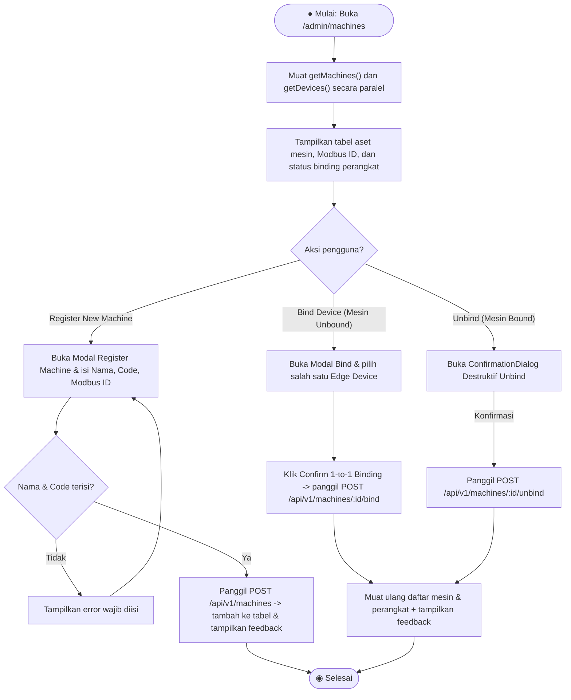

> **Status uji mutasi E2E — 19 Nov 2026** (`AUDIT.md` §35,
> `docs/E2E_MUTATION_TEST.md` L5–L6, C7–C8): **terverifikasi live** —
> create `CNC-TEST-E2E-01`, bind `STM32-OEE-TEST01`, unbind, dan delete
> mesin uji (cleanup C7–C8). Validasi server bekerja benar: Modbus
> Slave ID 1 duplikat ditolak ("Modbus slave ID 1 already assigned to
> machine CNC-MILLING-01"), diulang dengan Slave ID 2.

---

## 9. Products (`/admin/products`)

- **Rute**: `/admin/products` (alias: `/admin/production/products`)
- **Komponen**: `src/features/production/ProductsPage.tsx`
- **Hak Akses**: Menu sidebar tampil untuk `ADMIN` & `SUPERVISOR`; mutasi create/delete diblokir pada Remote Tunnel (`isReadOnly`)

### Deskripsi & Tujuan
Halaman katalog master produk (SKU) yang menyimpan parameter **Standard Ideal Cycle Time (detik)** dan status keaktifan SKU. Tujuannya adalah menyediakan tolok ukur waktu siklus desain (*benchmark* performa 100%) yang digunakan oleh mesin kalkulasi OEE untuk menghitung komponen **Performance**, serta meneruskan penghapusan ke backend (`409` jika SKU masih direferensikan oleh Work Order berstatus `PENDING` atau `ACTIVE`).

### Data yang Disajikan
| Bagian UI | Data / Kolom | Sumber Data | Tujuan Penyajian |
|---|---|---|---|
| **Tabel Products** | `SKU / Code` (mono), `Product Name` + `product_id`, `Standard Cycle Time` (satuan `s`), `Status` (`ACTIVE`/`INACTIVE`), `Actions` (tombol hapus; nonaktif pada Remote Tunnel) — tanpa `Category`, `Description`, maupun `Active Orders` | `GET /api/v1/products` | Menampilkan standar cycle time tiap SKU dan status aktifnya |
| **Modal Add New Product SKU** | Input `SKU Identifier`, `Product Name`, `Standard Ideal Cycle Time (Seconds)` (`> 0`) | Input pengguna (`POST /api/v1/products`) | Menambahkan master SKU baru ke katalog |
| **ConfirmationDialog Delete** | Nama & SKU produk, daftar dampak (SKU tidak bisa dipilih untuk WO baru, histori WO selesai menampilkan `[dihapus]`, ditolak 409 jika ada WO berstatus `PENDING` atau `ACTIVE`) | `DELETE /api/v1/products/:id` | Konfirmasi destruktif penghapusan SKU |

### Activity Diagram Workflow
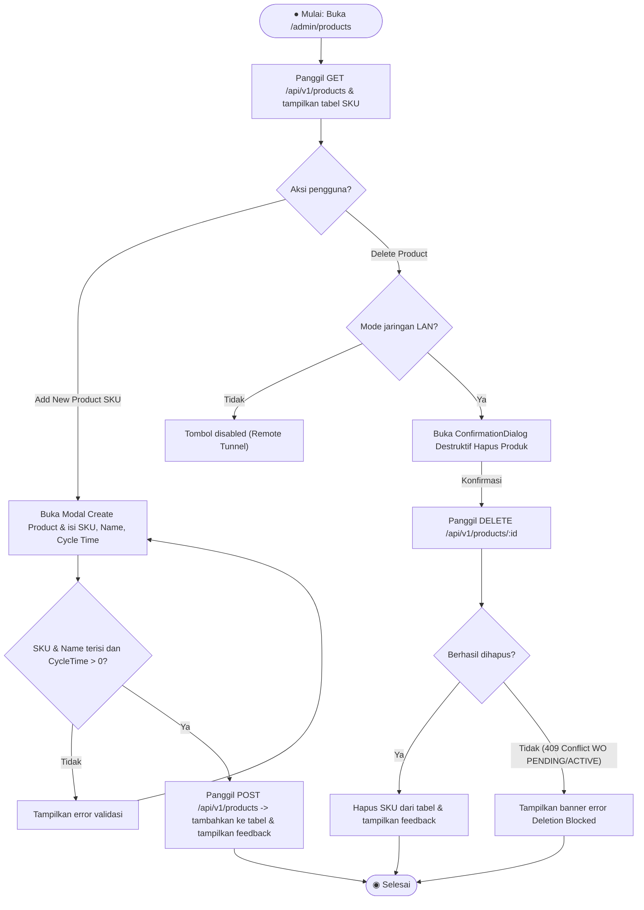

> **Status uji mutasi E2E — 19 Nov 2026** (`AUDIT.md` §35,
> `docs/E2E_MUTATION_TEST.md` L8–L9, C11): **terverifikasi live** —
> create `PROD-TEST-E2E-01`, edit (nama + cycle time 30 → 45 s/pcs),
> dan delete produk uji (cleanup C11). Observasi (bukan tiket): SKU
> yang diisi di form create tidak dikirim — baris menampilkan SKU
> `PROD-TEST-E2E-01` (SKU default = Product ID).

---

## 10. Operators (`/admin/operators`)

- **Rute**: `/admin/operators` (alias: `/admin/production/operators`)
- **Komponen**: `src/features/production/OperatorsPage.tsx`
- **Hak Akses**: `ADMIN` & `SUPERVISOR` (di LAN untuk mutasi registrasi, rotasi password, dan ubah status)

### Deskripsi & Tujuan
Halaman direktori personel pabrik dan pengelolaan akun operator berbasis **`operator_id`**, role RBAC, preferensi shift, status keaktifan, serta rotasi password sekali tulis (*write-only*). **Role adalah string bebas, bukan enum** (§H api_docs) — default `UNASSIGNED`; hanya `ADMIN` yang dibatasi untuk akun root `ADM-001`; daftar role otoritatif ada di `GET /access-control/roles`. Tujuannya adalah mengelola identitas operator yang dapat masuk ke sistem atau ditugaskan pada Work Order, sambil melindungi akun root administrator **`ADM-001`** dari penonaktifan atau penghapusan.

### Data yang Disajikan
| Bagian UI | Data / Kolom | Sumber Data | Tujuan Penyajian |
|---|---|---|---|
| **Tabel Operators** | `Operator ID` (mono, misal `ADM-001`, `EMP-0042`), `Operator Name` (badge `ROOT` untuk `ADM-001`) + `shift_preference` opsional, `Role & Access` (badge warna per role — nilai string bebas apa adanya), `Status` (`Active` / `Deactivated`), `Actions` (label `Akun dilindungi sistem` untuk `ADM-001`, atau tombol `Password` & `Activate`/`Deactivate`) — tanpa `Employee Code`, `email`, maupun `department` | `GET /api/v1/operators` | Mengelola daftar personel aktif dan hak akses dasarnya |
| **Modal Register Factory Operator** | Input `Operator ID`, `Full Name`, `Role` (dropdown string bebas, default `UNASSIGNED`), `Shift Preference`, `isActive` (default aktif), serta catatan penyediaan password sementara (di-hash Argon2id oleh API v1 backend) | `POST /api/v1/operators` | Mendaftarkan akun operator baru |
| **Modal Rotasi Password** | Input `Password Baru` (8–128 karakter, `type="password"`, tidak pernah ditampilkan ulang setelah disimpan) | `PATCH /api/v1/operators/:id/password` | Mengganti kredensial operator dengan aman |
| **ConfirmationDialog Toggle Status** | Nama & `operator_id`; jika menonaktifkan: dampak pada refresh token sesi aktif, pemblokiran login `/login` & Station, serta retensi data historis | `PATCH /api/v1/operators/:id/status` | Konfirmasi sebelum mengaktifkan/menonaktifkan akses login operator |

### Activity Diagram Workflow
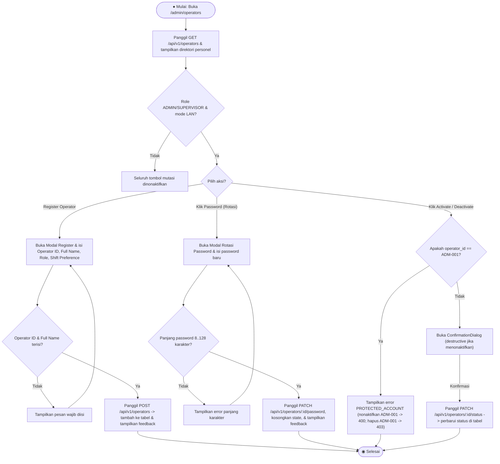

> **Status uji mutasi E2E — 19 Nov 2026** (`AUDIT.md` §35,
> `docs/E2E_MUTATION_TEST.md` L10–L13, C12): **terverifikasi live** —
> create `TST-E2E-01` (`UNASSIGNED`, `LINE-01`), edit profil, suspend
> lalu activate, rotasi password, dan delete operator uji (cleanup
> C12). Tombol Suspend `ADM-001` disabled ("Akun dilindungi (ADM-001)"),
> sesuai proteksi akun root.

---

## 11. Telemetry History (`/admin/telemetry`)

- **Rute**: `/admin/telemetry` (alias: `/admin/analytics/telemetry`)
- **Komponen**: `src/features/analytics/TelemetryHistoryPage.tsx`
- **Hak Akses**: Semua role dapat membaca & memfilter; ekspor khusus `ADMIN`/`SUPERVISOR`

### Deskripsi & Tujuan
Halaman arsip histori telemetri mentah (*raw time-series*) dari *hypertable* TimescaleDB untuk perangkat edge terpilih, dilengkapi pemilih rentang waktu (maksimal retensi 90 hari), paginasi cursor urutan menurun (*terbaru*), dan ekspor data dalam format CSV, NDJSON, maupun JSON. Tujuannya adalah memungkinkan inspeksi granular paket telemetri historis per detik/siklus (counter, OEE, cycle time, suhu, dan getaran) untuk investigasi teknis maupun pelaporan terstruktur.

### Data yang Disajikan
| Bagian UI | Data / Kolom | Sumber Data | Tujuan Penyajian |
|---|---|---|---|
| **HistoricalExportToolbar** | Preset waktu (`24 Jam`, `7 Hari`, `30 Hari`, `90 Hari`, `Kustom`), cakupan perangkat aktif, tombol `Export CSV` / `NDJSON` / `JSON`, receipt `X-Export-*` & validasi retensi | Context & state rentang waktu | Membatasi kueri dalam jendela waktu valid & mengunduh data mentah |
| **Device Selector Bar** | Dropdown pilih perangkat (`serial_number (device_id)`), informasi jumlah rekaman dimuat vs total | `GET /api/v1/devices` | Menentukan sumber perangkat untuk kueri log telemetri |
| **Tabel Raw Telemetry** | `Timestamp (UTC)`, `State` (FSM state), `Total / Good / Rej` (counter produksi), `OEE (%)`, `Cycle Time` (detik), `Thermal (°C)`, `Vibration (RMS mm/s)` | `GET /api/v1/telemetry/:device_id/history` (paginasi cursor) | Menyajikan detail metrik sensor dan produksi historis |
| **CursorPaginationBar** | Ringkasan jumlah dimuat, `next_cursor`, pemilih limit (`10`/`20`/`50`), tombol `Muat Lebih Banyak` & `Halaman Awal` | Metadata paginasi server | Memuat data historis secara bertahap tanpa overload |

### Activity Diagram Workflow


---

## 12. Shift Analytics / OEE Analytics (`/admin/shift-analytics`)

- **Rute**: `/admin/shift-analytics` (alias: `/admin/analytics/oee`)
- **Komponen**: `src/features/analytics/OeeAnalyticsPage.tsx`
- **Hak Akses**: Semua role (`ADMIN`, `SUPERVISOR`, `OPERATOR`, `MAINTENANCE`), mode baca saja (LAN & Remote Tunnel)

### Deskripsi & Tujuan
Halaman analitik OEE berbasis jendela shift yang menyajikan dekomposisi komponen **Availability**, **Performance**, dan **Quality** per mesin, garis waktu status FSM shift (*Shift State Timeline*), serta profil tren telemetri per jam untuk perangkat edge yang terikat ke mesin. Jika mesin belum memiliki `bound_device_id`, halaman secara jujur menampilkan bahwa tren per jam tidak tersedia tanpa data sintetis.

### Data yang Disajikan
| Bagian UI | Data / Metrik | Sumber Data | Tujuan Penyajian |
|---|---|---|---|
| **Selectors Bar** | Pemilih **Machine** (`name (code) · device_id/Unbound`), pemilih **Shift Window**, indikator normalisasi shift, & `Bound Telemetry Source` | `GET /api/v1/machines` & filter shift | Memilih mesin dan mengidentifikasi `bound_device_id` target |
| **KPI Decomposition Grid** | 4 `MetricCard`: **Shift OEE Index** (% vs target >=85%), **Availability Rate** (% + `Operating min / Planned min`), **Performance Rate** (% + `Run min` & `Total Parts`), **Quality Rate** (% + `Good parts` vs `Defect parts`) | `GET /api/v1/oee/shift-summary` | Memecah penyebab naik/turunnya OEE ke tiga pilar utama |
| **Shift State Timeline** | Strip visual & legenda segmen `RUNNING` / `DOWNTIME` / `READY` beserta durasi menit | `GET /api/v1/oee/shift-timeline` (bucket default **5m**) | Memvisualisasikan kronologi transisi FSM dalam jendela shift |
| **Hourly Telemetry Trend** | Daftar tren per jam untuk `bound_device_id` terpilih (atau pesan kosong jujur jika mesin `Unbound`): OEE %, A/P/Q %, progress bar, jumlah unit & cacat | `GET /api/v1/telemetry/:device_id/hourly` (limit default 72) | Melacak fluktuasi telemetri per jam perangkat edge terkait |

> **Catatan E20:** nilai `*Pct` yang `null` (bucket tanpa sampel / penyebut nol)
> dipertahankan `null` — bukan 0; shift-summary membaca `hourly[]` bila
> `include_hourly=true`; agregat OEE read-only (tunnel-safe, tanpa auth);
> `oeePct` null saat Performance null (D-8).

### Activity Diagram Workflow
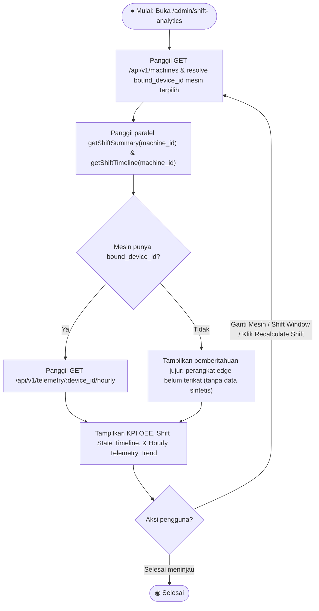

---

## 13. Quality & Rejects (`/admin/quality`)

- **Rute**: `/admin/quality` (alias: `/admin/analytics/quality`)
- **Komponen**: `src/features/analytics/QualityRejectsPage.tsx`
- **Hak Akses**: Semua role (`ADMIN`, `SUPERVISOR`, `OPERATOR`, `MAINTENANCE`), mode baca saja (LAN & Remote Tunnel)

### Deskripsi & Tujuan
Halaman analisis kualitas produksi dan *reject* per perangkat edge menggunakan pendekatan **Pareto 80/20** untuk memetakan penyebab produk cacat (*scrap*/*defect*). Jika perangkat terpilih tidak memiliki catatan cacat pada periode berjalan, UI menampilkan pesan jujur `"Tidak ada reject pada periode ini"` tanpa menampilkan angka yield palsu.

### Data yang Disajikan
| Bagian UI | Data / Metrik | Sumber Data | Tujuan Penyajian |
|---|---|---|---|
| **Device Selector** | Dropdown pilih perangkat (`device_id (bound_machine_name / serial_number)`) | `GET /api/v1/devices` | Menentukan perangkat target untuk kueri reject Pareto |
| **Ringkasan KPI Kualitas** | 3 `MetricCard`: **Total Defect Units** (jumlah unit cacat perangkat terpilih), **Top Contributor** (persentase & nama alasan terbesar), **Defect Categories** (jumlah jenis alasan reject tercatat) — tanpa nilai `Plant Quality Yield` hardcoded | `GET /api/v1/quality/rejects/:device_id` | Memberikan gambaran cepat tingkat cacat dan jumlah kategorinya |
| **Ranked Defect Causes & Cumulative Impact** | Daftar peringkat alasan cacat (atau pesan `"Tidak ada reject pada periode ini"` jika kosong): nomor urut, alasan (`reason`), jumlah unit, persentase, persentase kumulatif, & bar visual | `GET /api/v1/quality/rejects/:device_id` | Visualisasi distribusi Pareto 80/20 penyebab cacat per perangkat |

### Activity Diagram Workflow
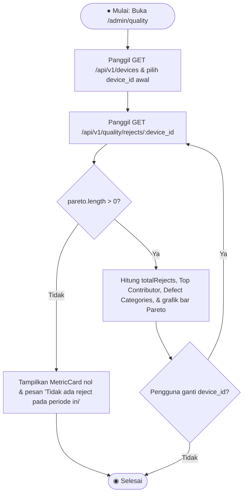

---

## 14. Data Reconciliation (`/admin/reconciliation`)

- **Rute**: `/admin/reconciliation` (alias: `/admin/analytics/reconciliation`)
- **Komponen**: `src/features/analytics/DataReconciliationPage.tsx`
- **Hak Akses**: Semua role dapat melihat status job; aksi `Force Refresh` hanya diizinkan untuk `ADMIN` & `SUPERVISOR` dari **LAN Pabrik** (`canForceReconciliationRefresh`)

### Deskripsi & Tujuan
Halaman pemantauan dan manajemen job rekonsiliasi **Continuous Aggregate (CAGG)** TimescaleDB yang bertugas melakukan *rollup* otomatis setiap 15 menit dan sinkronisasi data *backfill* pada *materialized view*. Tujuannya adalah memastikan data agregasi analitik OEE selalu sinkron dengan telemetri mentah serta memberi kemampuan *force refresh* manual secara terkendali (dilengkapi *rate limit* 60 detik per view untuk melindungi I/O database).

### Data yang Disajikan
| Bagian UI | Data / Kolom | Sumber Data | Tujuan Penyajian |
|---|---|---|---|
| **Tabel Reconciliation Jobs** | `Continuous Aggregate Job` (nama job), `Materialized View` (nama view mono), `Schedule Interval`, `Reconciliation Window` (jam & jumlah baris diproses), `Last Execution` (timestamp), `Job Status` (`last_status` dengan ikon sukses), `Manual Action` (tombol `Force Refresh`) | `GET /api/v1/telemetry/reconciliation/jobs` | Memantau kesehatan jadwal agregasi otomatis & hasil eksekusi terakhir |
| **Panel Kebijakan Rekonsiliasi** | Informasi interval otomatis 15 menit, syarat hak akses (`ADMIN`/`SUPERVISOR` di LAN), dan kebijakan rate-limit 1 permintaan per 60 detik per view | Teks kebijakan sistem | Mengedukasi operator mengenai batasan keamanan I/O database |
| **ConfirmationDialog Force Refresh** | Nama job & view, jendela waktu rekalkulasi, estimasi baris yang dihitung ulang, peringatan beban I/O & cooldown 60 detik | Konteks job terpilih | Konfirmasi berdampak layanan sebelum memicu rekalkulasi sinkron |

### Activity Diagram Workflow


> **Status uji mutasi E2E — 19 Nov 2026** (`AUDIT.md` §35,
> `docs/E2E_MUTATION_TEST.md` L44): **Force Refresh terverifikasi
> live** — kedua input datetime dikosongkan (body `{}`), server
> menjawab "Continuous aggregate oee_hourly_summary refreshed
> successfully."; jobs ter-refresh (Telemetry Reporter [1] SUCCESS,
> last run 19 Nov 2026 19.02). Tanpa cooldown/429.

---

## 15. Broker Overview (`/admin/mqtt/overview`)

- **Rute**: `/admin/mqtt/overview` (alias: `/admin/mqtt`)
- **Komponen**: `src/features/mqtt/BrokerOverviewPage.tsx`
- **Hak Akses**: Semua role pada menu/route langsung (di sidebar masuk grup MQTT & Connectivity)

### Deskripsi & Tujuan
Halaman ringkasan infrastruktur **Eclipse Mosquitto MQTT Broker** yang dikomposisikan dari `GET /api/v1/mqtt/dynamic-security/status` dan `GET /api/v1/mqtt/configuration/status` (tanpa memanggil `/mqtt/overview`). Tujuannya adalah menyajikan status plugin keamanan dinamis, jumlah klien/role/grup, serta status sinkronisasi konfigurasi broker sekaligus menjadi gerbang navigasi menuju sub-modul **Dynamic Security** dan **Broker Configuration Manager**.

### Data yang Disajikan
| Bagian UI | Data / Metrik | Sumber Data | Tujuan Penyajian |
|---|---|---|---|
| **Primary KPI Strip** | 4 `MetricCard`: **Broker Engine** (`Mosquitto 2.0.x` & status), **Dynamic Security Clients** (jumlah klien aktif, roles, & groups — `null` bila tak tersedia, bukan 0), **Dynamic Security** (status **`READY`** & `available`/`lastError`/`measuredAt`), **Configuration Sync** (`status` `IN_SYNC`/`APPLYING`/`FAILED`/`DRIFT`/`UNAVAILABLE`, `activeVersionId`, `lastAppliedAt`, `lastOperation`) — tanpa throughput `msg/s` atau uptime | `GET /api/v1/mqtt/dynamic-security/status`, `GET /api/v1/mqtt/dynamic-security/clients`, `GET /api/v1/mqtt/configuration/status` (§3.3a api_docs) | Memantau konektivitas plugin keamanan dan sinkronisasi konfigurasi broker |
| **Kartu Sub-modul Dynamic Security** | Status koneksi plugin, inventaris Roles & Groups, tautan langsung ke `/admin/mqtt/security` | Data komposisi status + navigasi | Penjelasan ringkas dan akses cepat manajemen ACL/klien |
| **Kartu Sub-modul Configuration Manager** | Versi konfigurasi aktif (`config_version`), waktu penerapan terakhir (`last_config_applied`), tautan langsung ke `/admin/mqtt/configuration` | Data status konfigurasi + navigasi | Penjelasan ringkas dan akses cepat manajemen konfigurasi `mosquitto.conf` |

### Activity Diagram Workflow
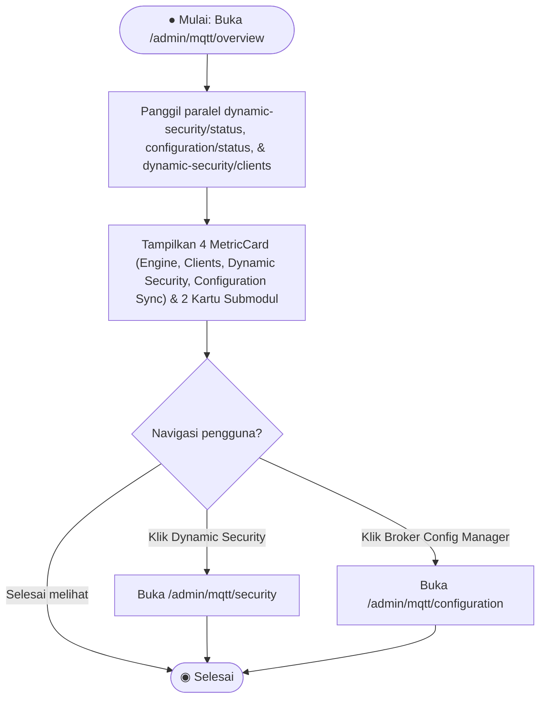

---

## 16. Dynamic Security (`/admin/mqtt/security`)

- **Rute**: `/admin/mqtt/security`
- **Komponen**: `src/features/mqtt/DynamicSecurityPage.tsx`
- **Hak Akses**: Khusus `ADMIN`; seluruh aksi mutasi (Provision, Enable/Disable, Revoke) hanya aktif di **LAN Pabrik** (`!isReadOnly && currentUser.role === 'ADMIN'`)

### Deskripsi & Tujuan
Halaman administrasi plugin **Mosquitto Dynamic Security (`mosquitto_ctrl`)** melalui topik `$CONTROL/dynamic-security/v1` untuk mengelola kredensial klien MQTT, peran (*roles*), aturan *Access Control List* (ACL) per topik, dan keanggotaan grup tanpa perlu me-restart daemon broker. **Provisioning perangkat TIDAK lagi di halaman ini** (E20): jalur kanonis adalah `POST /api/v1/devices/provision` di halaman Devices (§7); halaman ini hanya mengelola klien/role/grup dynsec yang sudah ada. Tujuannya adalah mengamankan jalur komunikasi MQTT perangkat edge secara granular.

### Data yang Disajikan
| Bagian UI (Tab) | Data / Elemen | Sumber Data | Tujuan Penyajian |
|---|---|---|---|
| **Tab 1: Clients** | Tabel klien: `Client Username`, `Client ID Pattern`, `Assigned Roles`, `Groups`, `Account State` (`Enabled`/`Disabled`), `Action` (`Enable`/`Disable`, `Revoke`) | `GET /api/v1/mqtt/dynamic-security/clients` | Mengaudit dan mengendalikan kredensial setiap node/klien MQTT |
| **Tab 2: Roles & ACLs** | Kartu per role: nama role, jumlah ACL, tabel aturan ACL (`Permission` ALLOW/DENY, `ACL Action Type`, `Topic Pattern`, `Priority`) | `GET /api/v1/mqtt/dynamic-security/roles` | Memeriksa izin publish/subscribe per pola topik |
| **Tab 3: Groups** | Kartu per grup: nama grup, `Inherited Roles`, daftar `Member Clients` | `GET /api/v1/mqtt/dynamic-security/groups` | Melihat pengelompokan klien dan pewarisan hak aksesnya |
| **Modal Create MQTT Client** | Form: `Username`, `Client ID Pattern` (opsional), `Pre-Shared Password`, `Assign Security Role` (wajib ≥1 peran); diikuti tampilan **Secret Sekali Tampil** dengan tombol `Salin` | Input admin & respons `POST /api/v1/mqtt/dynamic-security/clients` | Membuat akun MQTT baru dan menyerahkan secret secara aman (hilang permanen saat modal ditutup) |

### Activity Diagram Workflow
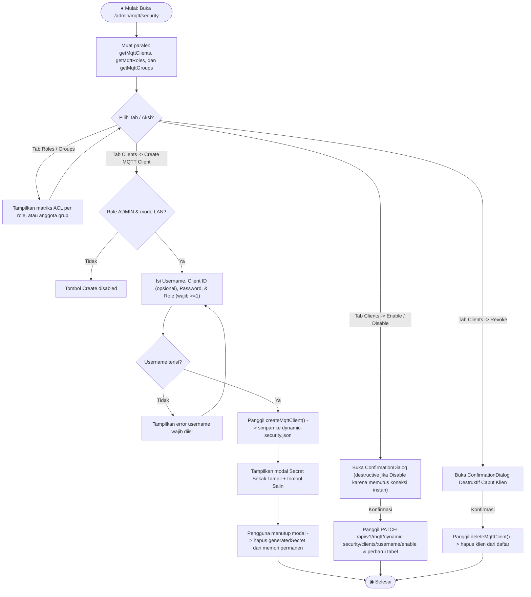

> **Status uji mutasi E2E — 19 Nov 2026** (`AUDIT.md` §35,
> `docs/E2E_MUTATION_TEST.md` L29–L37): create role `E2E-TEST-ROLE`,
> add ACL (topik literal `e2e/test` — wildcard `e2e/test/#` ditolak
> server: "Wildcards are not allowed in 'publishClientSend' topics"),
> create group `E2E-TEST-GROUP`, add role ke group, remove ACL, delete
> role, dan delete group **terverifikasi live**. **MUT-01 (panel,
> Medium — FAT-227):** mutasi DynSec berulang kali menampilkan banner
> merah palsu "Koneksi jaringan terputus atau backend tidak
> terjangkau." padahal mutasi sukses di server, dan list tampil stale
> sampai halaman di-remount via navigasi sidebar (L29, L30, L35, L37).
> **MUT-02 (backend, High — FAT-228):** create MQTT client
> `e2e-test-client` selalu gagal "Role not found" (5× — role
> `E2E-TEST-ROLE` ×4 termasuk dari halaman yang baru di-remount, dan
> role `admin` ×1); client tidak pernah tercipta. Akibatnya attach
> role ke client (L32), rotasi password client (L33), disable/enable
> client (L34), dan add client ke group (L36) **BELUM teruji**.
> Caveat MUT-02: modal create-client meng-hardcode default
> `cRoles=['edge_publisher']` (`CreateMqttClientModal.tsx:21`) yang
> tidak ada di server — perlu log body request aktual untuk menutup
> caveat ini. Catatan cleanup: hapus role otomatis membersihkan
> keanggotaan group (C5); hapus group yang masih berisi anggota belum
> teruji (C6 — group sudah kosong saat dihapus).

---

## 17. Broker Configuration Manager (`/admin/mqtt/configuration`)

- **Rute**: `/admin/mqtt/configuration` dan `/admin/mqtt/configuration/*`
- **Komponen**: `src/features/mqtt/BrokerConfigManagerPage.tsx`
- **Hak Akses**: `ADMIN` (baca & tulis di LAN); `SUPERVISOR` (baca-saja)

### Deskripsi & Tujuan
Halaman manajemen siklus hidup konfigurasi infrastruktur daemon Mosquitto (`mosquitto.conf`) berbasis versi. Seluruh sub-tab beroperasi pada satu dokumen kandidat lokal (*proposed config*) dengan alur terkendali: edit konfigurasi, validasi, pratinjau *diff* (*Current vs Proposed*), persetujuan admin dengan catatan audit (*Change Summary*), penerapan async, hingga **Rollback** ke versi snapshot sebelumnya. Apply/rollback adalah **operasi async**: server menjawab **202 `{operationId, versionId}`** (body `{confirm: true}`) dan panel melakukan polling `GET /operations/:operationId` hingga status terminal (`PENDING`/`RUNNING` → `SUCCEEDED`/`FAILED`). Tujuannya adalah mencegah kesalahan konfigurasi broker yang dapat melumpuhkan telemetri seluruh pabrik.

### Data yang Disajikan
| Bagian UI (5 Tab) | Data / Elemen | Sumber Data | Tujuan Penyajian |
|---|---|---|---|
| **1. Editor** | Pengaturan global (`Per-Listener Settings`, `Allow Anonymous`, `Database Persistence`, `Autosave Interval`), daftar listener (`Port`, `Protocol`, TLS, `Bind Address`, `Max Connections`, `Enabled`), kartu profil TLS, daftar bridge, form batas daemon (`Max Allowed Client Connections`, `Max Inflight Messages`, `Max Packet Size`, `Max Queued Messages`) | `proposedConfig` (dari `GET /api/v1/mqtt/configuration`) | Mengonfigurasi seluruh aspek broker dalam satu dokumen kandidat |
| **2. Versions** | Tabel riwayat versi: `Version ID`, `Change Summary`, `Operator`, `Applied Timestamp`, `Operation` (`RELOAD`/`ROLLBACK`), `Status` (`STAGED`/`ACTIVE`/`ROLLED_BACK`), tombol `Apply` / `Rollback` | `GET /api/v1/mqtt/configuration/configurations` | Audit histori konfigurasi dan pemulihan cepat jika terjadi kendala |
| **3. Operations** | Daftar operasi async: `Operation ID`, `Type` (`NO_OPERATION`/`RELOAD`/`RESTART`), `Status` (`PENDING`/`RUNNING`/`SUCCEEDED`/`FAILED`), hasil polling | `GET /api/v1/mqtt/configuration/operations` & `.../operations/:operationId` | Memantau penerapan/rollback yang berjalan |
| **4. Backups** | Inventaris backup (metadata + `filename`, tanpa path internal) | `GET /api/v1/mqtt/configuration/backups` | Melihat cadangan konfigurasi otomatis (dibuat saat apply/rollback; **`POST /backups` tidak disediakan — 404**) |
| **5. Raw** | Blok konfigurasi mentah (`GET /api/v1/mqtt/configuration/raw`) + pratinjau diff bergaya unified (`Active` vs `Proposed`), indikator operasi `RELOAD (SIGHUP) — No Broker Downtime` | Perbandingan `currentConfig` vs `proposedConfig` + `/raw` | Verifikasi visual perubahan sebelum dieksekusi |

> **Catatan E20:** field tanpa sumber nyata bernilai `null` (mis. `limits.max_connections`,
> `bridges[].remote_client_id`/`status`; `tls_profiles` selalu `[]`); stage menerima
> `config` + `baseVersionId?` + `reason` atau alias `summary`; error 422 dual
> `issues[]` + `details`; `acknowledgeUnvalidated` tidak ada di api_docs (R-16).

### Activity Diagram Workflow
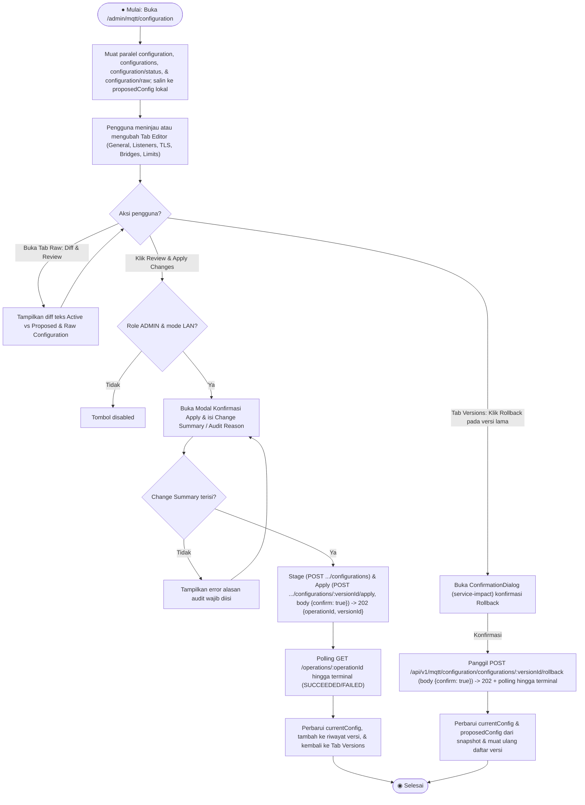

> **Status uji mutasi E2E — 19 Nov 2026** (`AUDIT.md` §35,
> `docs/E2E_MUTATION_TEST.md` L38–L40): **editor tidak render** —
> tab "Editor & Simpan Draf" kosong di setiap load dan banner merah
> persisten "Live configuration '/mosquitto/config/mosquitto.conf' is
> not readable: ENOENT: no such file or directory"; Versions (0),
> Deployments (0), Backups (0). Akar masalah sama dengan **E2E-08
> (backend, High — FAT-222)**: `mosquitto.conf` live tidak terbaca di
> host API — jangan buat tiket baru untuk ini. **Stage (L38), diff
> versi staged (L39), dan discard (L40) TIDAK teruji**; tidak ada
> Apply/Rollback yang diklik.

---

## 18. System Health (`/admin/system/health`)

- **Rute**: `/admin/system/health`
- **Komponen**: `src/features/system/SystemHealthPage.tsx`
- **Hak Akses**: Semua role (`ADMIN`, `SUPERVISOR`, `OPERATOR`, `MAINTENANCE`), mode baca saja (LAN & Remote Tunnel)

### Deskripsi & Tujuan
Halaman diagnostik infrastruktur layanan microservice untuk memantau hasil *health probe* secara langsung (`GET /health`) terhadap layanan **API v1**, **TimescaleDB / PostgreSQL**, dan buffer ingest telemetri tanpa menampilkan field runtime yang tidak tersedia di backend (versi Fastify, `pool_active`/`pool_max`, dan `records_per_second`). **Detail infrastruktur** (E20, §A api_docs) tersedia lewat `GET /health/detail` — **ADMIN + LAN** — dengan status terukur per komponen (`application`, `database`, `mqtt`, `websocket`) plus `measuredAt` masing-masing; nilai tak tersedia = `null`/`UNKNOWN`, bukan `0`/`UP` (latensi database diukur nyata `SELECT 1`, timeout → `DOWN`, `latencyMs: null`).

### Data yang Disajikan
| Bagian UI | Data / Metrik | Sumber Data | Tujuan Penyajian |
|---|---|---|---|
| **Top KPI Cards** | 4 `MetricCard`: **Overall Health** (status + uptime), **Backend Latency** (ms, label `API v1`), **TimescaleDB Latency** (ms + engine `TimescaleDB / PostgreSQL` tanpa `pool_active`/`pool_max`), **Telemetry Buffer** (`buffer_utilization_pct` tanpa `records_per_second`) | `GET /health` | Pemantauan cepat latensi dan utilisasi buffer sistem |
| **API v1 Backend Service Card** | `Service Status`, `Backend Label` (`API v1`), `Execution Perimeter` | `health.backend` | Informasi diagnostik runtime layanan API |
| **TimescaleDB / PostgreSQL Card** | `Engine Type`, `Query Ping Latency` (ms), `Database Status` | `health.database` | Memantau kesehatan koneksi basis data time-series |
| **Detail Infrastruktur (ADMIN + LAN)** | Kartu per komponen dari `GET /health/detail`: `application` (`name`, `version` dari `APP_VERSION`, `environment` dari `NODE_ENV`, `uptimeSeconds`), `database` (status + `latencyMs` terukur), `mqtt` (status admin + klien), `websocket` (status relay) — masing-masing dengan `measuredAt`; nilai tak tersedia tampil `null`/`UNKNOWN` | `GET /health/detail` | Diagnostik mendalam yang hanya boleh dilihat ADMIN dari LAN |

### Activity Diagram Workflow
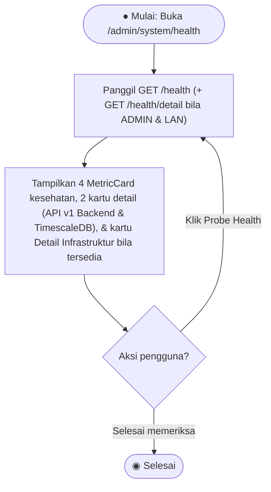

---

## 19. Access Control / IAM (`/admin/access-control`)

- **Rute**: `/admin/access-control` (alias: `/admin/system/access-control`)
- **Komponen**: `src/features/system/AccessControlPage.tsx`
- **Hak Akses**: Khusus `ADMIN` dan hanya muncul di menu pada akses **LAN Pabrik** (`minRole: 'ADMIN', lanOnly: true`); mutasi dinonaktifkan pada Remote Tunnel

### Deskripsi & Tujuan
Konsol tata kelola **Identity & Access Management (IAM)** berbasis **Casbin RBAC/ABAC & Scope Hierarkis** untuk mengelola custom role, katalog permission, penetapan cakupan operator (*Scope Assignments*), aturan policy Casbin (dengan proteksi *anti-lockout* untuk `ADMIN`), serta audit log keputusan otorisasi. Header halaman membaca **`GET /api/v1/access-control/info`** dan menampilkan badge mode otorisasi (`shadow`/`enforce` — tanpa `"partial"`) beserta `authzVersion`.

### Data yang Disajikan
| Bagian UI | Data / Elemen | Sumber Data | Tujuan Penyajian |
|---|---|---|---|
| **Header Governance** | Badge mode otorisasi dari `GET /api/v1/access-control/info`: **`AKTIF` (mode `enforce`)** atau mode `shadow` + `Pembaruan #<authzVersion>`; tombol `Reload IAM` | `GET /api/v1/access-control/info` | Menampilkan mode evaluasi otorisasi yang benar-benar berlaku di server |
| **Tab 1: Roles** | Tabel role: `Role Identifier` (gembok hanya untuk `ADMIN` — satu-satunya yang immutable), `Classification` (`SYSTEM PROTECTED` / `CUSTOM`), `Description`, jumlah assignment, tombol hapus khusus custom role / preset tak terpakai — **tanpa kolom `Privilege Level`** (backend tidak mengembalikannya) | `GET /api/v1/access-control/roles` | Mengelola definisi role sistem dan custom role |
| **Tab 2: Permissions** | Tabel katalog `Action` × `Resource Target Type`, deskripsi, & form tambah permission (didukung: tanpa rute penjaga → `400 INERT_PERMISSION`; duplikat → `409 PERMISSION_EXISTS`) | `GET /api/v1/access-control/permissions`, `POST /api/v1/access-control/permissions` | Referensi & pendaftaran predikat aksi dan tipe resource yang valid |
| **Tab 3: Scope Assignments** | Tabel penugasan: `Operator` (nama & ID, default `EMP-0115`), `Role`, `Scope Hierarchy` (`ORGANIZATION` s.d. `DEVICE`), `Scope Boundary Target`, tombol hapus | `GET /api/v1/access-control/user-roles` | Mengikat operator & role pada batas cakupan hierarki tertentu |
| **Tab 4: Casbin Policies** | Tabel aturan policy: `Rule ID`, `Role Subject`, `Action Predicate`, `Resource Pattern`, `Effect` (`ALLOW`/`DENY`), `Status` (`Active`/`Disabled`), toggle aktif/nonaktif & hapus (terkunci untuk `ADMIN`); body tulis **camelCase** (`{roleId, permissionId, resourcePattern, effect, abacCondition}`), **tanpa field `reason`** di baris policy | `GET /api/v1/access-control/policies` | Mengatur aturan eksplisit izin atau penolakan Casbin |
| **Tab 5: Subject Inspector** | Detail operator: `primaryRole`, `isActive`/`isProtected`, `authzVersion`, `effectiveInMode`, `assignments[]`, **`roles[]`** (satu-satunya nama field — tanpa alias `effectiveRoles`), `permissions[]` | `GET /api/v1/access-control/subjects/:operatorId/effective-permissions` | Memeriksa hak efektif satu operator |
| **Tab 6: Decision Audit** | Log keputusan real-time: `Timestamp`, `Subject`, `Decision` (`ALLOW`/`DENY`), `Mode`, `Action`, `Resource Target`; filter `subject`/`decision`/`mode`/`from`/`to` | `GET /api/v1/access-control/audit` | Memverifikasi riwayat keputusan otorisasi |

### Activity Diagram Workflow
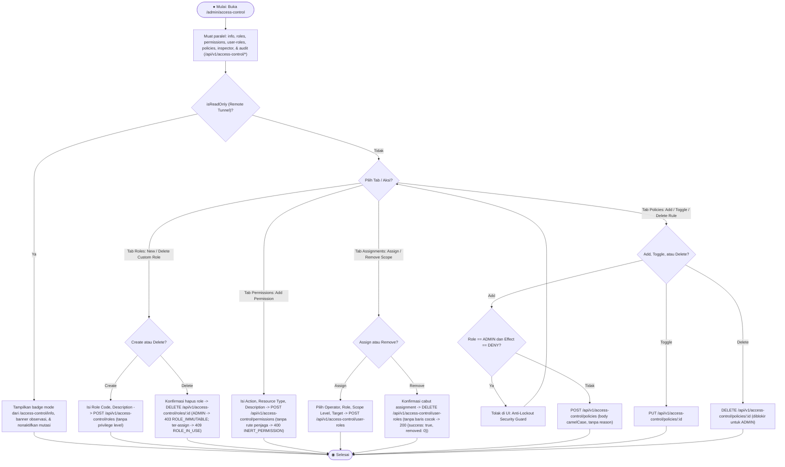

> **Status uji mutasi E2E — 19 Nov 2026** (`AUDIT.md` §35,
> `docs/E2E_MUTATION_TEST.md` L16–L28): **terverifikasi live** — create
> role `TEST-E2E-ROLE`, update role, create policy, toggle
> disable→enable, update policy (2×), bind permission ke role, assign
> role ke operator, inspector effective permission, revoke assignment,
> unbind permission, delete policy, dan delete role (authz_version
> naik #1→#10). **Guard 409 `ROLE_IN_USE` terverifikasi live** (L24):
> hapus role saat ter-assign ditolak server ("Role 'TEST-E2E-ROLE' is
> still assigned to 'TST-E2E-01' (ROLE_IN_USE)."). **Guard pasif ADMIN
> terverifikasi** (bukan temuan): kartu role ADMIN tanpa tombol
> Edit/Hapus; baris policy ADMIN Edit/Disable/Delete disabled; Revoke
> assignment ADMIN–ADM-001 disabled ("Anti-Lockout Guard: role ADMIN
> pada akun dilindungi tidak dapat dicabut."); opsi DENY untuk ADMIN
> disabled di modal Add Policy. **MUT-03 (panel, Medium — FAT-229):**
> policy create dengan ABAC kosong mengirim `abacCondition: null`
> eksplisit dan ditolak server ("Invalid policy: abacCondition Invalid
> input: expected record, received null" — L18; "body/abacCondition
> ..." — L21); field harus di-omit saat kosong. Akar: rantai null
> `parseAbacCondition` → `createPolicy`/`handleBindPermission` →
> `createIamPolicy`/`addIamRolePermission` (`iam.ts:248-266, 124/135`),
> plus asumsi salah di `schemas/dto.ts:235` yang menganggap null sah.
> Catatan: jalur `PUT /policies/{id}` justru mengizinkan
> nullable(record) — hanya kedua jalur POST create yang salah.
> Observasi (bukan tiket): `authz_version` #7 berulang di L21/L22/L25
> (counter tampak tidak naik pada assign/revoke); `read:telemetry`
> tidak ada di katalog live (dipakai `refresh:telemetry`); opsi
> RESERVED (`manage:access_control`, `manage:mqtt_admin`,
> `manage:mqtt_configuration`, `read_raw:mqtt_configuration`) tampil
> "(DIBLOKIR - RESERVED)" dan disabled.

---

## 20. Audit Trail (`/admin/system/audit`)

- **Rute**: `/admin/system/audit`
- **Komponen**: `src/features/system/AuditTrailPage.tsx`
- **Hak Akses**: `ADMIN` & `SUPERVISOR` (mode baca saja, dapat diakses dari LAN & Remote Tunnel)

### Deskripsi & Tujuan
Halaman jejak audit kepatuhan sistem (*immutable compliance audit trail*) yang mencatat seluruh mutasi administratif, perubahan konfigurasi, manajemen keamanan, serta mode jaringan tempat aksi dilakukan (`LAN` vs `REMOTE_TUNNEL`). Seluruh data dimuat dari **`GET /api/v1/system/audit`** — alias feed operasional (`OperationalEventItem[]`, §I api_docs) — **bukan** dari `/access-control/audit` (itu audit keputusan otorisasi IAM, terpisah; lihat §19 Tab 6). Halaman ini juga menyediakan **ekspor** `GET /api/v1/system/audit/export` (CSV/NDJSON/JSON, retensi 90 hari, guard `authorize("read","access_control")`).

### Data yang Disajikan
| Bagian UI | Data / Kolom | Sumber Data | Tujuan Penyajian |
|---|---|---|---|
| **Filter Toolbar** | Dropdown `Event Type` (enum kanonis 32 nilai + pola), dropdown `Machine`, pencarian teks | State filter lokal + query server (`event_type`, `machine_id`) | Memfokuskan audit pada tipe event / mesin tertentu |
| **Search Bar** | Input pencarian berdasarkan `event_type`, `description`, `machine_id`, atau `device_id` | Filter lokal | Menelusuri aktivitas administrator atau resource tertentu |
| **Tabel Audit Trail** | `Timestamp` (`recordedAt`), `Event Type` (kode event mono), `Target` (nama mesin & `device_id`/`machine_id`), `Deskripsi`, `Status Ack` (`Acknowledged` + `acknowledgedBy`/`acknowledgedAt` atau `Unacknowledged`) — tanpa kolom aktor/IP/mode karangan | `GET /api/v1/system/audit` | Menyajikan catatan kronologis mutasi sistem secara transparan |
| **Toolbar Ekspor** | Tombol ekspor `CSV` / `NDJSON` / `JSON` (filter sama dengan daftar) + receipt/error (`RETENTION_EXCEEDED` di luar 90 hari, rate limit 5/menit) | `GET /api/v1/system/audit/export` | Mengunduh jejak audit untuk kepatuhan |

### Activity Diagram Workflow
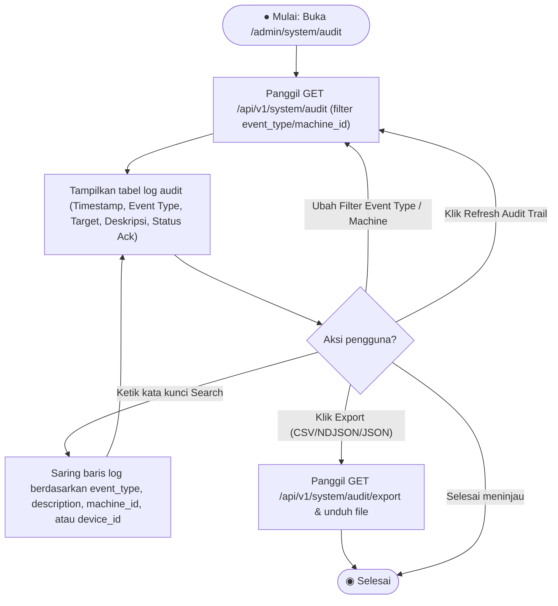

> **Status uji mutasi E2E — 19 Nov 2026** (`AUDIT.md` §35,
> `docs/E2E_MUTATION_TEST.md` §7): seluruh mutasi sesi uji tercatat
> sebagai entri audit trail append-only (termasuk ack event 1148 oleh
> ADM-001 dan cancel `WO-SIM-20260906-02` menjadi `ABORTED`). Halaman
> ini tidak diuji interaktif selama sesi mutasi — ack dilakukan lewat
> halaman Operational Events (§5).

---

## 21. System Information (`/admin/system/info`)

- **Rute**: `/admin/system/info`
- **Komponen**: `src/features/system/SystemInfoPage.tsx`
- **Hak Akses**: Semua role (`ADMIN`, `SUPERVISOR`, `OPERATOR`, `MAINTENANCE`), halaman referensi statis

### Deskripsi & Tujuan
Halaman referensi arsitektur teknis, topologi multi-lapisan IIoT, batas keamanan jaringan (*Dual-VHost*), serta standar rumus perhitungan OEE (**TPM Six Big Losses**) yang digunakan di seluruh platform. Tujuannya adalah menjadi dokumentasi internal yang selalu tersedia di dalam aplikasi bagi tim teknis, supervisor, dan auditor.

### Data yang Disajikan
| Bagian UI | Data / Konten | Sumber Data | Tujuan Penyajian |
|---|---|---|---|
| **Multi-Tier IIoT Architecture** | Penjelasan 4 lapisan: **1. Edge Layer** (ESP32-S3 FreeRTOS, Modbus RTU/TCP, MQTT TLS), **2. Transport Layer** (Mosquitto 2.0 + Dynamic Security), **3. Backend Ingestion** (API v1 + TimescaleDB + WebSocket), **4. Administration UI** (React SPA + role guards) | Konten referensi statis | Menjelaskan alur teknis sistem dari edge ke UI |
| **Dual-VHost Network Security Boundary** | Penjelasan segmentasi **Local Factory LAN (VHost 1)** vs **Remote Cloud Tunnel (VHost 2)** yang memblokir metode mutasi pada Nginx reverse proxy | Konten referensi statis | Memperjelas alasan pembatasan fitur saat diakses secara remote |
| **OEE Calculation Standards** | Formula matematis & penjelasan rugi untuk **Availability (%)**, **Performance (%)**, dan **Quality (%)** sesuai TPM Six Big Losses | Konten referensi statis | Menyamakan pemahaman standar kalkulasi metrik OEE antar pengguna |
| **Mode Otorisasi Sesi** | Penjelasan mode evaluasi dari `GET /auth/me`: **`Simulasi`** (mode `shadow`) vs **`Penegakan Aktif`** (mode `enforce`) — tanpa mode `"partial"` | `GET /api/v1/auth/me` | Menjelaskan apakah policy dinamis sedang ditegakkan atau hanya disimulasikan |

### Activity Diagram Workflow
```mermaid
flowchart TD
    Start(["● Mulai: Buka /admin/system/info"]) --> RenderRef["Tampilkan kartu Arsitektur Multi-Tier IIoT, Batas Keamanan Dual-VHost, & Standar Formula OEE"]
    RenderRef --> End(["◉ Selesai: Pengguna selesai membaca referensi"])
```

---

## 22. Force Change Password (`/force-change-password`)

- **Rute**: `/force-change-password` (di luar `AdminLayout`, tanpa sidebar/topbar)
- **Komponen**: `src/features/auth/ForceChangePasswordPage.tsx`
- **Hak Akses**: Hanya untuk sesi dengan `mustChangePassword` aktif (flag dari respons login 200 / `GET /auth/me`, atau 403 `PASSWORD_ROTATION_REQUIRED` dari rute terproteksi)

### Deskripsi & Tujuan
Halaman gerbang ganti-password-wajib (spec 043, §L api_docs). Selama gerbang aktif, halaman ini adalah **satu-satunya jalan keluar** — tanpa jalur kedua: tidak ada navigasi lain, dan keluar hanya lewat ganti password yang sukses (atau logout). Tujuannya adalah menegakkan rotasi password sementara sebelum operator boleh masuk ke panel.

### Data yang Disajikan
| Bagian UI | Data / Elemen | Keterangan |
|---|---|---|
| Header Peringatan | Ikon + penjelasan bahwa password wajib diganti sebelum lanjut | Konteks gerbang spec 043 |
| Form Ganti Password | Input `Password Saat Ini`, `Password Baru` (min. 8 karakter, harus berbeda dari yang lama), `Konfirmasi Password Baru` | Body `{current_password, new_password}` ke `POST /api/v1/auth/password/change`; sukses → gerbang tertutup (flag `mustChangePassword` false, `authz_version` naik, token lama `401 AUTHZ_STALE`) lalu redirect ke `/admin` |
| Feedback & Throttle | Pesan error inline; 429 memakai `Retry-After` server | Throttle hanya dari server; tanpa lockout lokal |
| Tombol Logout | Keluar dari sesi (satu-satunya jalan keluar selain ganti password) | `AuthContext.logout` |

### Activity Diagram Workflow
```mermaid
flowchart TD
    Start(["● Mulai: Gerbang aktif (flag login / 403 PASSWORD_ROTATION_REQUIRED)"]) --> RenderGate["Tampilkan halaman /force-change-password (tanpa AdminLayout, tanpa navigasi lain)"]
    RenderGate --> Input["Isi Password Saat Ini, Password Baru (>=8, != lama), & Konfirmasi"]
    Input --> Validate{"Validasi lokal lolos?"}
    Validate -- Tidak --> ShowErr["Tampilkan pesan error (min. 8 / konfirmasi tidak cocok / sama dengan lama)"]
    ShowErr --> Input
    Validate -- Ya --> Submit["Panggil changePassword() -> POST /api/v1/auth/password/change"]
    Submit --> Result{"Berhasil?"}
    Result -- Ya --> CloseGate["Gerbang tertutup oleh AuthContext; redirect ke /admin"]
    CloseGate --> End(["◉ Selesai"])
    Result -- Tidak --> ShowApiErr["Tampilkan pesan error API (termasuk 429 + Retry-After bila ada)"]
    ShowApiErr --> Input
    RenderGate -- "Klik Logout" --> Logout["Keluar dari sesi"]
    Logout --> End
```

---

## 23. Production Lines (`/admin/lines`)

- **Rute**: `/admin/lines`
- **Komponen**: `src/features/production/ProductionLinesPage.tsx`
- **Hak Akses**: Semua role dapat membaca; mutasi `ADMIN` di LAN (semua mutasi `ADMIN` LAN only, §N api_docs)

### Deskripsi & Tujuan
Halaman master production line (lini produksi) — unit organisasi tempat mesin dan jadwal shift berada. Tujuannya adalah mengelola daftar lini beserta status keaktifannya; penghapusan dijaga guard berurutan dalam satu transaksi: masih dirujuk `machines` → 409 `PRODUCTION_LINE_IN_USE` (sebut `machineId`), snapshot `work_orders` → 409 (sebut `woId`), `operators.line_id` → 409 (sebut `operatorId`, FR-036-10/11).

### Data yang Disajikan
| Bagian UI | Data / Kolom | Sumber Data | Tujuan Penyajian |
|---|---|---|---|
| **Tabel Production Lines** | `Line ID` (mono), `Line Name`, `Description`, `Status` (`Active`/`Inactive`), `Actions` (Edit/Delete) | `GET /api/v1/production-lines` (cursor pagination, `limit` 1..100) | Menampilkan daftar lini produksi |
| **Modal Create / Edit Line** | Input `Line ID` (hanya saat create), `Line Name`, `Description`, `isActive` | `POST /api/v1/production-lines`, `PUT /api/v1/production-lines/:id` | Menambah/mengubah lini |
| **ConfirmationDialog Delete** | Nama & ID lini, daftar dampak (guard 409 bila masih dirujuk mesin / WO snapshot / operator) | `DELETE /api/v1/production-lines/:id` | Konfirmasi destruktif penghapusan lini |

### Activity Diagram Workflow
```mermaid
flowchart TD
    Start(["● Mulai: Buka /admin/lines"]) --> LoadLines["Panggil getProductionLinesPage(cursor, limit) & tampilkan tabel"]
    LoadLines --> Action{"Aksi pengguna?"}
    Action -- "Create / Edit" --> OpenForm["Buka Modal & isi Line ID (create saja), Name, Description, isActive"]
    OpenForm --> CallSave["Panggil POST /production-lines atau PUT /production-lines/:id"]
    CallSave --> LoadLines
    Action -- "Delete" --> ConfirmDel["Buka ConfirmationDialog"]
    ConfirmDel -- Konfirmasi --> CallDel["Panggil DELETE /api/v1/production-lines/:id"]
    CallDel --> DelRes{"Berhasil?"}
    DelRes -- Ya --> LoadLines
    DelRes -- "Tidak (409 PRODUCTION_LINE_IN_USE)" --> ShowErr["Tampilkan error guard + pemakai (machineId/woId/operatorId)"]
    ShowErr --> End(["◉ Selesai"])
    Action -- "Muat Lebih Banyak" --> LoadLines
```

---

## 24. Shifts (`/admin/shifts`)

- **Rute**: `/admin/shifts`
- **Komponen**: `src/features/production/ShiftsPage.tsx`
- **Hak Akses**: Semua role dapat membaca; mutasi `ADMIN` di LAN

### Deskripsi & Tujuan
Halaman master shift kerja (jendela waktu kerja) — definisi jam `startTime`/`endTime` yang dirujuk oleh Shift Schedules dan snapshot Work Order. Perubahan jam shift yang menimbulkan overlap jadwal pada `line_id`+`day_of_week` yang sama → 409 `SHIFT_TIME_OVERLAP` dengan detail `{shiftId, lineId, dayOfWeek, conflictShiftId}` (§P api_docs); perubahan nama/kode tidak memicu validasi. Hapus shift ditolak bila masih dirujuk `shift_schedules` atau snapshot `work_order` → 409 `SHIFT_IN_USE`.

### Data yang Disajikan
| Bagian UI | Data / Kolom | Sumber Data | Tujuan Penyajian |
|---|---|---|---|
| **Tabel Shifts** | `Shift ID` (mono), `Shift Code`, `Shift Name`, `Start Time`, `End Time`, `Status` (`Active`/`Inactive`), `Actions` (Edit/Delete) | `GET /api/v1/shifts` (cursor pagination) | Menampilkan daftar shift kerja |
| **Modal Create / Edit Shift** | Input `Shift ID` (hanya saat create), `Shift Code`, `Shift Name`, `Start Time`, `End Time`, `isActive` | `POST /api/v1/shifts`, `PUT /api/v1/shifts/:id` | Menambah/mengubah shift |
| **ConfirmationDialog Delete** | Nama & ID shift, daftar dampak (guard 409 `SHIFT_IN_USE` bila masih dirujuk jadwal/WO snapshot) | `DELETE /api/v1/shifts/:id` | Konfirmasi destruktif penghapusan shift |

### Activity Diagram Workflow
```mermaid
flowchart TD
    Start(["● Mulai: Buka /admin/shifts"]) --> LoadShifts["Panggil getShiftsPage(cursor, limit) & tampilkan tabel"]
    LoadShifts --> Action{"Aksi pengguna?"}
    Action -- "Create / Edit" --> OpenForm["Buka Modal & isi Shift ID (create saja), Code, Name, Start/End Time, isActive"]
    OpenForm --> CallSave["Panggil POST /shifts atau PUT /shifts/:id"]
    CallSave --> SaveRes{"Berhasil?"}
    SaveRes -- Ya --> LoadShifts
    SaveRes -- "Tidak (409 SHIFT_TIME_OVERLAP)" --> ShowOverlap["Tampilkan error overlap + conflictShiftId"]
    ShowOverlap --> End(["◉ Selesai"])
    Action -- "Delete" --> ConfirmDel["Buka ConfirmationDialog"]
    ConfirmDel -- Konfirmasi --> CallDel["Panggil DELETE /api/v1/shifts/:id"]
    CallDel --> DelRes{"Berhasil?"}
    DelRes -- Ya --> LoadShifts
    DelRes -- "Tidak (409 SHIFT_IN_USE)" --> ShowInUse["Tampilkan error shift masih dipakai"]
    ShowInUse --> End
    Action -- "Muat Lebih Banyak" --> LoadShifts
```

---

## 25. Shift Schedules (`/admin/shift-schedules`)

- **Rute**: `/admin/shift-schedules`
- **Komponen**: `src/features/production/ShiftSchedulesPage.tsx`
- **Hak Akses**: Semua role dapat membaca; mutasi `ADMIN` di LAN

### Deskripsi & Tujuan
Halaman jadwal shift per lini — pasangan (`line_id`, `day_of_week`, `shift_id`) yang menentukan shift mana yang berjalan di lini mana pada hari apa. List dan detail memuat `shiftName`, `shiftCode`, `startTime`, `endTime` dari join shift yang sama (bila jam shift berubah, jam jadwal ikut berubah; bila shift yang dirujuk hilang, field shift bernilai `null`). Filter query **hanya snake_case** (`line_id`, `day_of_week`, `shift_id`, `is_active` — §P:1676, Q-036-05; tidak ada alias camelCase).

### Data yang Disajikan
| Bagian UI | Data / Kolom | Sumber Data | Tujuan Penyajian |
|---|---|---|---|
| **Filter Toolbar** | Dropdown `Line`, dropdown `Day of Week`, dropdown `Shift` | State filter → query snake_case | Menyaring jadwal per lini/hari/shift |
| **Tabel Shift Schedules** | `Line` (nama & ID), `Day of Week`, `Shift` (`shiftName`/`shiftCode`), `Start Time`, `End Time` (dari join shift), `Status` (`Active`/`Inactive`), `Actions` (Edit/Delete) | `GET /api/v1/shift-schedules` (filter `line_id`/`day_of_week`/`shift_id`/`is_active` + cursor pagination) | Menampilkan jadwal shift per lini |
| **Modal Create / Edit Schedule** | Pilih `Line`, pilih `Shift`, pilih `Day of Week`, `isActive` | `POST /api/v1/shift-schedules`, `PUT /api/v1/shift-schedules/:id` | Menambah/mengubah jadwal |

### Activity Diagram Workflow
```mermaid
flowchart TD
    Start(["● Mulai: Buka /admin/shift-schedules"]) --> LoadMeta["Muat daftar lines & shifts untuk dropdown filter/form"]
    LoadMeta --> LoadSch["Panggil getShiftSchedulesPage({line_id?, day_of_week?, shift_id?, is_active?}) & tampilkan tabel (dengan shiftName/shiftCode/startTime/endTime dari join)"]
    LoadSch --> Action{"Aksi pengguna?"}
    Action -- "Ubah Filter" --> LoadSch
    Action -- "Create / Edit" --> OpenForm["Buka Modal & pilih Line, Shift, Day of Week, isActive"]
    OpenForm --> CallSave["Panggil POST /shift-schedules atau PUT /shift-schedules/:id"]
    CallSave --> LoadSch
    Action -- "Delete" --> ConfirmDel["Buka ConfirmationDialog"]
    ConfirmDel -- Konfirmasi --> CallDel["Panggil DELETE /api/v1/shift-schedules/:id"]
    CallDel --> LoadSch
    Action -- "Muat Lebih Banyak" --> LoadSch
```
